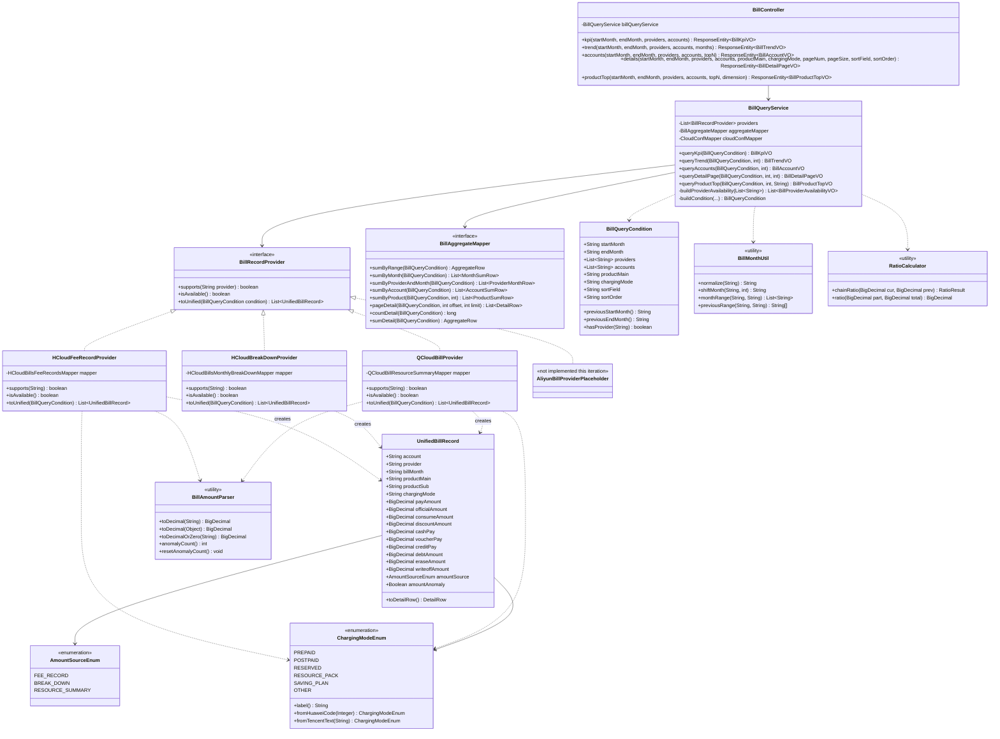
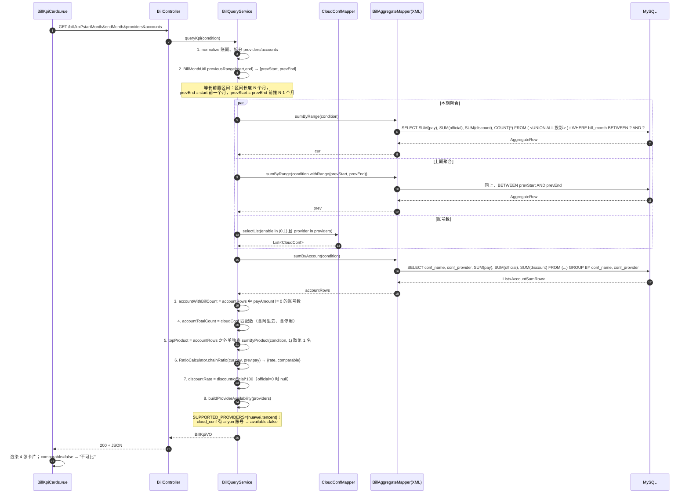
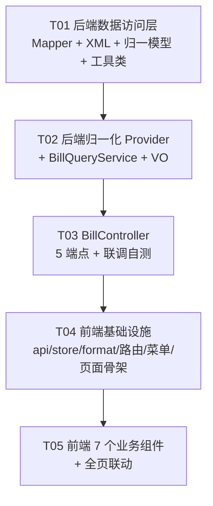

# 统一账单页 架构设计与任务分解

| 项 | 内容 |
| --- | --- |
| 文档语言 | 中文 |
| 模块名称 | `unified_bill_page`（多云统一账单页） |
| 上游输入 | `docs/03-模块文档/统一账单页-PRD.md` |
| 后端栈 | Spring Boot 4.0.3 / Java 25 / MyBatis-Plus 3.5.16（mybatis-plus-spring-boot3-starter + jsqlparser）/ MySQL |
| 前端栈 | Vue 3.5 + Vite 8 + Element Plus 2.14 + ECharts 6 + vue-echarts 8 + Pinia 3 + axios |
| 作者 | 架构师 高见远 |

---

## 0. 现有工程事实核对（已实际 Read 确认，工程师直接采信）

设计基于以下核实结论，**不要凭猜测改列名**：

| 事实 | 证据位置 | 结论 |
| --- | --- | --- |
| MyBatis-Plus 驼峰下划线自动映射已开启 | `backend/src/main/resources/application.yaml` 中 `mybatis.configuration.map-underscore-to-camel-case: true` | 华为云两表用标准驼峰映射即可，**无需手写 @TableField** |
| 腾讯云实体字段是**大写开头** | `QCloudBillResourceSummary.java`：`private String BusinessCodeName;` `private String CashPayAmount;` 等 | 业务字段**无 @TableField 注解**。不能依赖 MyBatis-Plus 自动映射（大写开头 → 会推导成 `businesscodename` 之类的错误列名）。**必须显式写 @TableField 或在 SQL 里写真实列名**。已在 XML 里直接写真实列名规避该风险 |
| 腾讯云三个特例字段有显式映射 | `@TableField(value = "original_cost_with_ri")`、`@TableField(value = "sp_deduction")` | 列名不是 `spdeduction`（虽然表里还有一个残留的 `spdeduction` 列，是历史脏列，**不要用**） |
| 华为云费用记录表列名 | `database/schema.sql` 第 27-64 行 | `bill_cycle / service_type_name / resource_type_name / charging_mode / trade_time / official_amount / official_discount_amount / erase_amount / consume_amount / cash_amount / credit_amount / coupon_amount / flexipurchase_coupon_amount / stored_value_card_amount / bonus_amount / debt_amount / writeoff_amount / region_name` 全部为下划线小写 |
| 华为云月度明细表列名 | `database/schema.sql` 第 70-124 行 | `amortized_cash_amount / amortized_coupon_amount / amortized_credit_amount / bill_cycle / shared_month / sub_service_type_name / sub_resource_type_name` 等 |
| 腾讯云账单表列名 | `database/schema.sql` 第 738-785 行 | `business_code_name / product_code_name / pay_mode_name / total_cost / real_total_cost / voucher_pay_amount / cash_pay_amount / incentive_pay_amount / pay_time / month / region_name` 全部为小写下划线；**`tags` 为 json** |
| `month` 列在腾讯云表里**存在但不在建表脚本展示区** | 实体 `private String month;` | 注意：`schema.sql` 第 738-785 行的建表语句里**没有 `month` 列**，而实体有 `month` 字段，`schema_new_qcloud*.sql` 中可能补充了该列。见 §7 待明确事项 U1，工程上必须先 `DESC q_cloud_bill_resource_summary` 验证 |
| `conf_name / conf_provider / conf_region` | `BasicEntityExtend.java` | 三个扩展字段无显式列名，标准驼峰映射 → `conf_name / conf_provider / conf_region`；与 `CommonSqlInjector` 里硬编码的 `WHERE conf_name = ...` 一致，可确认为真实列名 |
| `deleted` 逻辑删除 | `BasicEntity.java`：`@TableLogic(value = "0", delval = "1")` | 用 MyBatis-Plus 的 `selectPage` / `selectList` 时**自动追加 `deleted = 0`**；但用自定义 `@Select` / XML 手写 SQL 时**不会自动追加**，必须手动写 `AND deleted = 0` |
| 分页插件已注册 | `config/MybatisPlusConfig.java`：`interceptor.addInnerInterceptor(new PaginationInnerInterceptor())` | 数据库类型未显式指定，会从 JDBC URL 自动推断 MySQL，可直接用 `Page<T>` |
| Mapper 扫描 | `MixedCloudResourceStatApplication.java`：`@MapperScan("com.linjicong.cloud.stat.dao.mapper")` | 新增 mapper 放在 `dao.mapper.bill` 包下**会被自动扫描**，无需改配置 |
| Mapper XML 存放位置 | `application.yaml`：`mybatis.mapper-locations: classpath:mapping/*Mapper.xml` | XML 必须放 `backend/src/main/resources/mapping/` 下，文件名以 `Mapper.xml` 结尾。**当前该目录不存在，本模块是首次引入 XML**，见 §7 U5 |
| 响应包装风格 | `SummaryController` / `StatisticsController` / `CloudConfigController` 全部返回 `ResponseEntity<Map<String,Object>>` 或 `ResponseEntity<List<T>>`，错误时 `ResponseEntity.status(500).body(Map.of("error", ...))` | **项目无统一 `R<T>` 包装**。本模块保持一致：`ResponseEntity<...>` 直接返回业务对象。**不要引入新的 R 包装**，否则前端 axios 拦截器与既有约定全部要改 |
| 前端 axios 封装 | `frontend/src/apis/cloud.js`：`baseURL: '/api'`，响应拦截器 `return response`（**返回完整 AxiosResponse，业务数据在 `.data`**） | 新增 API 方法必须沿用 `response.data` 取值风格 |
| 前端 proxy | `frontend/vite.config.js`：`/api` → `http://localhost:8080`，并 `rewrite` 去掉 `/api` 前缀 | 后端端点 `/bill/*`，前端写 `/bill/*` 即可（axios baseURL 加 `/api`，proxy 再剥掉） |
| 路径别名 | `vite.config.js`：`'@' → ./src` | 可直接 `import x from '@/views/bill/...'` |
| Element Plus 自动导入 | `vite.config.js` 中 `unplugin-auto-import` + `unplugin-vue-components` + `ElementPlusResolver`；同时 `main.js` 里也 `app.use(ElementPlus)` 全量注册 | 模板里 `<el-xxx>` 直接用；`ElMessage` 等函数式调用建议显式 `import { ElMessage } from 'element-plus'`（与 `apis/cloud.js` 保持一致） |
| ECharts 已注册的组件 | `frontend/src/main.js`：`CanvasRenderer, PieChart, LineChart, BarChart, TitleComponent, TooltipComponent, LegendComponent, GridComponent`；全局组件名 `VChart` | **`DataZoomComponent`、`MarkLineComponent`、`MarkPointComponent`、`ToolboxComponent`、`GraphicComponent` 均未注册**。若要用必须先在 `main.js` 补 `use([...])`。本设计刻意只用已注册组件，见 §3.5 |
| ECharts 全局注册方式 | `main.js`：`app.component('VChart', VChart)` | 模板直接用 `<VChart>`，无需在每个组件里 import |
| 菜单结构 | `frontend/src/App.vue` 第 17-68 行 | "跨云汇总" 是第 21-24 行的 `<el-menu-item index="/summary">`，新菜单插在它后面 |
| 路由结构 | `frontend/src/router/index.js` 第 14-19 行是 `/summary` 路由 | 新路由插在 `/summary` 之后 |
| 现有账单端点（不可复用） | `ResourceController` 第 365 行 `@GetMapping("/huawei/{type}")`、第 466 行 `@GetMapping("/tencent/{type}")` | 返回**全量 List、无聚合、无分页、无金额换算**，本模块**不复用、不修改**它 |
| 后端无全局异常处理器 | `exception/` 只有 `ClientException.java` | 每个 Controller 方法内部 try/catch，与现有 `StatisticsController` 写法一致 |
| 后端可用工具类 | `util/` 下有 `BeanUtils`、`ReflectAsmUtil` 等，`pom.xml` 含 `hutool`（`ClientException` 用到 `cn.hutool.core`） | 可用 `StrUtil.isBlank` / `NumberUtil`。但金额转换建议自写，行为可控 |

### 0.1 三张表与统一模型的对应关系（含真实列名）

| 统一字段 | 华为云 fee_records（真实列） | 华为云 break_down（真实列） | 腾讯云 resource_summary（真实列） |
| --- | --- | --- | --- |
| 账号 | `conf_name` | `conf_name` | `conf_name` |
| 厂商 | `conf_provider` | `conf_provider` | `conf_provider` |
| 账期 | `bill_cycle` | `bill_cycle` | `month`（待验证，见 U1） |
| 实付 | `cash_amount + coupon_amount + credit_amount` | `amortized_cash_amount + amortized_coupon_amount + amortized_credit_amount` | `cash_pay_amount + voucher_pay_amount + incentive_pay_amount`（字符串） |
| 原价 | `official_amount` | 无 → 用 `consume_amount` 占位（不参与"优惠"计算） | `total_cost`（字符串） |
| 优惠后应付 | `consume_amount` | `consume_amount` | `real_total_cost`（字符串） |
| 优惠额 | `official_discount_amount` | 无 → 0 | `total_cost - real_total_cost`（兜底计算） |
| 产品大类 | `service_type_name` | `service_type_name` | `business_code_name` |
| 产品子类 | `resource_type_name` | `sub_resource_type_name`（空则 `resource_type_name`） | `product_code_name` |
| 计费模式 | `charging_mode`（Integer 需字典） | `charging_mode`（Integer 需字典） | `pay_mode_name`（已文本） |
| 地域 | `region_name` | `region_name` | `region_name` |
| 资源 ID/名 | `trade_id`（无资源ID）/ 无 | `resource_id` / `resource_name` | `resource_id` / `resource_name` |
| 交易时间 | `trade_time` | `effective_time` | `pay_time` |
| 欠费 | `debt_amount` | 无 | 无 |
| 抹零 | `erase_amount` | 无 | 无 |
| 核销 | `writeoff_amount` | 无 | 无 |
| 现金 | `cash_amount` | `amortized_cash_amount` | `cash_pay_amount` |
| 代金券 | `coupon_amount` | `amortized_coupon_amount` | `voucher_pay_amount` |
| 信用/赠送 | `credit_amount` | `amortized_credit_amount` | `incentive_pay_amount` |

---

## 1. 实现方案总览

### 1.1 核心设计思路：三层归一 + SQL 优先

```
┌─────────────────────────────────────────────────────────────┐
│ 表现层 BillController  (5 个只读端点，全部 GET)              │
├─────────────────────────────────────────────────────────────┤
│ 编排层 BillQueryService                                      │
│  · 参数校验 / 账期归一 / 筛选条件构造                         │
│  · 串行调用归一数据源 → 内存做"不可 SQL 化"的聚合（环比、占比）│
├─────────────────────────────────────────────────────────────┤
│ 归一化层 BillRecordProvider 接口（关键扩展点）                │
│  ├─ HCloudFeeRecordProvider     → UnifiedBillRecord          │
│  ├─ HCloudBreakDownProvider     → UnifiedBillRecord          │
│  ├─ QCloudBillProvider          → UnifiedBillRecord          │
│  └─ (预留) ACloudBillProvider   → 返回空列表 + unavailable    │
│  · 金额安全转换 / 计费模式字典映射 / 账期归一 / null 填 0      │
├─────────────────────────────────────────────────────────────┤
│ 数据访问层 dao.mapper.bill.BillAggregateMapper (XML)          │
│  · 用 UNION ALL 把三张表投影成同一列形状，SQL 侧完成          │
│    WHERE 过滤 + GROUP BY + SUM + ORDER BY + LIMIT/OFFSET      │
└─────────────────────────────────────────────────────────────┘
```

**为什么"归一化层"要做成 Provider 接口而不是一个 if/else？**

阿里云账单表当前不存在，PRD 明确要求"页面以暂无账单数据占位，不影响合计"。如果用 if/else，后续阿里云账单采集上线后必须改 Service 里的分支判断；做成 `BillRecordProvider` SPI 后，只需新增一个 `@Component` 实现类并加进 `List<BillRecordProvider>`，`BillQueryService` 零改动。Provider 接口同时承载"该厂商是否有账单数据"这个能力（`supports()` + `isAvailable()`），让前端能拿到 `providerAvailability` 而不是靠猜。

### 1.2 关键决策（工程师按此实现，不要自行更改）

| 编号 | 决策点 | 决策 | 理由 |
| --- | --- | --- | --- |
| D1 | 金额聚合走 SQL 还是内存 | **KPI / 趋势 / 账号维度 / 产品 TOP / 明细分页，全部走 SQL 聚合**；内存只做"占比、环比、TOP-N 排序截断、sparkline 组装"这类无法用一条 SQL 表达的二次计算 | 华为云 `h_cloud_bills_fee_records` 与 `q_cloud_bill_resource_summary` 是**按资源/按交易的明细级表**，单账号单月可达数千到数万行。若把明细全量拉进 JVM 再 SUM，一次 12 个月 × 10 账号的查询会加载 10 万+ 行对象，GC 与序列化开销远超收益。SQL 侧 `SUM` 只返回几十行，是数量级差异 |
| D2 | 明细分页 | **必须服务端分页**：SQL `LIMIT ? OFFSET ?` + 独立 `COUNT(*)`。**严禁内存 `subList` 切页** | 明细表数据量不可控，内存切页 = 全量加载，一次翻到第 500 页仍要全表扫描。PRD 验收项 6 明确要求"服务端分页且 total 准确" |
| D3 | 腾讯云字符串金额如何参与 SQL 聚合 | 在 SQL 里用 `SUM(CAST(NULLIF(TRIM(col), '') AS DECIMAL(18,4)))`，同时**保留 Java 侧 `BillAmountParser.toDecimal` 作为唯一权威口径**用于明细行展示；两处口径必须一致：`'-'` → SQL `NULLIF` 处理不了（`'-'` 不是空串），因此 **SQL 里额外用 `NULLIF(TRIM(col), '-')`**。见 §2.6 给出的完整表达式 | 若只靠 Java 转换，聚合就得把明细拉回内存（违反 D1）；若只靠 SQL，明细行的"异常计数"无法统计。两处并存但表达式统一定义，且有单测兜底 |
| D4 | 金额精度类型 | 统一用 `BigDecimal`，`scale = 2`，`RoundingMode.HALF_UP`；DTO 中金额字段类型为 `BigDecimal`；SQL 侧 `CAST(... AS DECIMAL(18,4))`，聚合结果再在 Java 里 `setScale(2)` | 三张表原始列是 `double`（华为）和 `varchar`（腾讯），`double` 累加 1000 行会产生 0.01 级误差，PRD 验收项 1 要求"≤0.01 元误差"。`BigDecimal` 从聚合第一步就介入，误差归零。**禁止在 Service 里用 `double` 做金额运算** |
| D5 | 环比 | 后端计算并返回 `BigDecimal rate`（百分比数值，如 `12.34` 表示 +12.34%）+ `Boolean comparable`；**为 null 时不返回 0**，由前端显示"不可比" | 若后端返回 0，前端无法区分"持平"与"不可比"。用 `comparable` 显式表达，避免前端做 `rate === null` 的隐式约定 |
| D6 | 华为云实付口径 | **只用 fee_records 表（现金+代金券+信用）**，`h_cloud_bills_monthly_break_down` 的摊销金额**完全不参与任何聚合**。break_down 表**仅用于明细列表的补充数据源**（当 fee_records 某账期无数据时，明细行可来自 break_down，并打 `amountSource=BREAK_DOWN` 角标） | PRD Q1 + 表 5.2 硬约束："绝不与主口径混算"。若不这样约束，工程师很容易在两个 Provider 里各 SUM 一遍然后相加 → 总额翻倍 |
| D7 | 阿里云 | `AliyunBillProvider` 实现类**本期不创建**（避免"有类但永远返空"的误导）。改为 `BillQueryService` 内维护 `SUPPORTED_PROVIDERS = {huawei, tencent}`，并对 `cloud_conf` 里存在的 `aliyun` 账号返回 `available=false` | 少写一个空类；用配置数据驱动"哪些厂商有账单能力"，比硬编码空实现更诚实 |
| D8 | 计费模式枚举 | 后端统一为 6 值文本枚举：`包年包月 / 按需 / 预留实例 / 资源包 / 节省计划 / 其他`；华为 `charging_mode` 的 Integer 映射表见 §2.7 | PRD 5.4 硬约束 |
| D9 | 是否为明细表新增"账号停用"字段 | **不做**。账号启停从 `cloud_conf.enable` 在账号维度接口里 join 出来，明细行不带 | 明细行数据量大，多一个冗余字段成本高于收益；前端账号列 hover 时用账号维度接口返回的 map 反查即可 |
| D10 | 分页 total 的来源 | **独立 `COUNT(*)` 查询**（`BillAggregateMapper.countDetail`），不复用 `Page` 的自动 count | 因为明细查询是 UNION ALL 三表，`Page` 的自动 count 会包裹整个 UNION 且 count SQL 生成质量不可控（含 ORDER BY 时性能极差）。手写 count SQL 更可控 |
| D11 | 默认账期范围 | 前端默认 = 当前月往前 2 个月 ~ 当前月（近 3 个月，含当月）；后端**不设默认**，要求 `startMonth` / `endMonth` 必传（`@RequestParam` 非 required=false 但 Service 内兜底） | PRD Q4 |
| D12 | 账期归一为 `YYYY-MM` | 在 Provider 内做 `BillMonthUtil.normalize(String)`：接受 `2025-03` / `2025-3` / `202503` / `2025/03` / `2025-03-01`，统一输出 `2025-03`；无法解析返回 `null`，该行被丢弃并计入 `droppedRowCount` | 两张华为表 `bill_cycle` 格式由 SDK 决定，不一定与腾讯 `month` 一致（PRD 5.1 已提示）。丢弃行要计数，不能静默 |

### 1.3 阿里云扩展点（留给后续版本）

1. `BillRecordProvider` 接口 + `List<BillRecordProvider>` 注入，新增厂商只需加实现类。
2. `BillQueryService.SUPPORTED_PROVIDERS` 常量从 `"huawei","tencent"` 改为三值即可。
3. `BillAggregateMapper.xml` 的 UNION ALL 里预留了一段注释掉的阿里云 SELECT 骨架（列形状与统一模型对齐），取消注释 + 填列名即可接上。
4. KPI / 趋势接口返回 `providerAvailability: [{provider, available, message}]`，前端据 `available=false` 渲染"该厂商账单数据暂未采集"占位，**未来不需要改前端**。

---

## 2. 后端设计

### 2.1 分层与新增文件列表

包根 `com.linjicong.cloud.stat`。所有路径相对项目根。

| # | 相对路径 | 类型 | 职责 |
| --- | --- | --- | --- |
| 1 | `backend/src/main/java/com/linjicong/cloud/stat/controller/BillController.java` | 新增 | 5 个只读端点，`@RequestMapping("/bill")`，方法内 try/catch |
| 2 | `backend/src/main/java/com/linjicong/cloud/stat/service/bill/BillQueryService.java` | 新增 | 编排：参数归一、调用 Mapper、二次计算（占比/环比/TOP截断/sparkline） |
| 3 | `backend/src/main/java/com/linjicong/cloud/stat/service/bill/provider/BillRecordProvider.java` | 新增 | 归一化 SPI 接口 |
| 4 | `backend/src/main/java/com/linjicong/cloud/stat/service/bill/provider/HCloudFeeRecordProvider.java` | 新增 | 华为云 fee_records → 统一模型 |
| 5 | `backend/src/main/java/com/linjicong/cloud/stat/service/bill/provider/HCloudBreakDownProvider.java` | 新增 | 华为云 break_down 摊销口径（仅明细补充源） |
| 6 | `backend/src/main/java/com/linjicong/cloud/stat/service/bill/provider/QCloudBillProvider.java` | 新增 | 腾讯云 resource_summary → 统一模型 |
| 7 | `backend/src/main/java/com/linjicong/cloud/stat/service/bill/bo/UnifiedBillRecord.java` | 新增 | **统一账单模型 BO** |
| 8 | `backend/src/main/java/com/linjicong/cloud/stat/service/bill/bo/BillQueryCondition.java` | 新增 | 统一查询条件（账期起止 + 厂商 + 账号 + 产品 + 计费模式 + 排序） |
| 9 | `backend/src/main/java/com/linjicong/cloud/stat/service/bill/bo/AmountSourceEnum.java` | 新增 | `FEE_RECORD / BREAK_DOWN / RESOURCE_SUMMARY` |
| 10 | `backend/src/main/java/com/linjicong/cloud/stat/service/bill/bo/ChargingModeEnum.java` | 新增 | 6 值计费模式 + `fromHuaweiCode(Integer)` + `fromTencentText(String)` |
| 11 | `backend/src/main/java/com/linjicong/cloud/stat/service/bill/util/BillAmountParser.java` | 新增 | `toDecimal(Object)` / `toDecimal(String)` 安全金额解析 + 异常计数 |
| 12 | `backend/src/main/java/com/linjicong/cloud/stat/service/bill/util/BillMonthUtil.java` | 新增 | 账期归一 `normalize(String)`、按月偏移 `shiftMonth(String,int)`、生成月份区间 `monthRange(start,end)`、等长前置区间 `previousRange(start,end)` |
| 13 | `backend/src/main/java/com/linjicong/cloud/stat/service/bill/util/RatioCalculator.java` | 新增 | 占比、环比（含 `comparable` 判定） |
| 14 | `backend/src/main/java/com/linjicong/cloud/stat/dao/mapper/bill/BillAggregateMapper.java` | 新增 | 自定义聚合查询接口（`@Mapper` 由 `@MapperScan` 自动扫到） |
| 15 | `backend/src/main/resources/mapping/BillAggregateMapper.xml` | 新增 | 全部聚合 SQL（UNION ALL 投影 + GROUP BY + LIMIT） |
| 16 | `backend/src/main/java/com/linjicong/cloud/stat/controller/dto/bill/BillKpiVO.java` | 新增 | KPI 响应 VO |
| 17 | `backend/src/main/java/com/linjicong/cloud/stat/controller/dto/bill/BillTrendVO.java` | 新增 | 趋势响应 VO |
| 18 | `backend/src/main/java/com/linjicong/cloud/stat/controller/dto/bill/BillAccountVO.java` | 新增 | 账号维度响应 VO |
| 19 | `backend/src/main/java/com/linjicong/cloud/stat/controller/dto/bill/BillDetailPageVO.java` | 新增 | 明细分页响应 VO |
| 20 | `backend/src/main/java/com/linjicong/cloud/stat/controller/dto/bill/BillProductTopVO.java` | 新增 | 产品 TOP 响应 VO |
| 21 | `backend/src/main/java/com/linjicong/cloud/stat/controller/dto/bill/BillProviderAvailabilityVO.java` | 新增 | 厂商可用性（阿里云占位用） |

> 注：项目现有代码没有独立的 VO 包，Controller 直接返回 `Map`。本模块**引入 DTO 类**而不是 `Map`，原因是 5 个端点响应结构固定且含嵌套列表，用 `Map` 会迫使前端对照文档猜字段、也让 `BigDecimal` 序列化行为不可控。

### 2.2 统一账单模型 `UnifiedBillRecord`

```java
package com.linjicong.cloud.stat.service.bill.bo;

@Data
@Builder
@NoArgsConstructor
@AllArgsConstructor
public class UnifiedBillRecord {
    // ---------- 维度 ----------
    /** 账号名，取 conf_name */
    private String account;
    /** 厂商标识：huawei / tencent / aliyun（小写） */
    private String provider;
    /** 厂商中文名：华为云 / 腾讯云 / 阿里云 */
    private String providerLabel;
    /** 地域，取 conf_region，空则回退 region_name */
    private String region;
    /** 账期，统一 YYYY-MM */
    private String billMonth;
    /** 产品大类（华为 service_type_name / 腾讯 business_code_name） */
    private String productMain;
    /** 产品子类（华为 resource_type_name 或 sub_resource_type_name / 腾讯 product_code_name） */
    private String productSub;
    /** 计费模式统一文本，见 ChargingModeEnum */
    private String chargingMode;
    /** 计费模式原始值（华为 Integer 的字符串形式 / 腾讯原文），便于排查 */
    private String chargingModeRaw;
    /** 资源 ID */
    private String resourceId;
    /** 资源名称 */
    private String resourceName;
    /** 交易/扣费时间，原样字符串，不做时区转换 */
    private String tradeTime;

    // ---------- 金额（全部 BigDecimal，scale=2） ----------
    /** 实付金额（本模块唯一主口径） */
    private BigDecimal payAmount;
    /** 原价 */
    private BigDecimal officialAmount;
    /** 优惠后应付 */
    private BigDecimal consumeAmount;
    /** 优惠额 = officialAmount - consumeAmount，负数按 0 兜底 */
    private BigDecimal discountAmount;
    /** 现金部分（构成拆解用，不参与再次求和） */
    private BigDecimal cashPay;
    /** 代金券部分 */
    private BigDecimal voucherPay;
    /** 信用/赠送账户部分 */
    private BigDecimal creditPay;
    /** 欠费（不计入实付，仅展示） */
    private BigDecimal debtAmount;
    /** 抹零（不计入实付，仅展示） */
    private BigDecimal eraseAmount;
    /** 核销（不计入实付，仅展示） */
    private BigDecimal writeoffAmount;

    // ---------- 元信息 ----------
    /** 金额来源表 */
    private AmountSourceEnum amountSource;
    /** 该行是否存在金额转换失败（前端打"数据异常"角标） */
    private Boolean amountAnomaly;
}
```

**字段与三张表的唯一映射实现位置**：`HCloudFeeRecordProvider` / `HCloudBreakDownProvider` / `QCloudBillProvider` 的 `toUnified(...)` 方法是**全项目唯一允许出现"厂商原始字段名"的地方**（除 Mapper XML）。Service 层只看 `UnifiedBillRecord`，不允许出现 `cash_pay_amount` 这种字样。

### 2.3 接口设计（5 个端点）

统一前缀 `/bill`。**全部 GET**（只读，便于前端缓存与直接浏览器调试验证）。分页参数用 `pageNum` / `pageSize`（与项目其它地方无冲突）。

公共请求参数（除特别说明，5 个端点都接受）：

| 参数 | 类型 | 必填 | 说明 |
| --- | --- | --- | --- |
| `startMonth` | String | 是 | 账期起，`YYYY-MM` |
| `endMonth` | String | 是 | 账期止，`YYYY-MM`，含 |
| `providers` | String | 否 | 逗号分隔，如 `huawei,tencent`；空 = 全部 |
| `accounts` | String | 否 | 逗号分隔的 `conf_name`；空 = 全部 |
| `productMain` | String | 否 | 产品大类精确筛选（仅明细与 TOP 使用） |
| `chargingMode` | String | 否 | 计费模式文本精确筛选（仅明细使用） |

公共响应片段 `providerAvailability`（仅 KPI 与趋势返回）：

```json
[
  { "provider": "huawei",  "label": "华为云", "available": true,  "accountCount": 3, "message": null },
  { "provider": "tencent", "label": "腾讯云", "available": true,  "accountCount": 5, "message": null },
  { "provider": "aliyun",  "label": "阿里云", "available": false, "accountCount": 2, "message": "该厂商账单数据暂未采集" }
]
```

`available=false` 的判定：`cloud_conf` 中该 `provider` 有启用账号，但该厂商不在 `SUPPORTED_PROVIDERS` 内（即阿里云）。若该厂商既无账号又不支持，则**不出现在数组里**。

---

#### 2.3.1 `GET /bill/kpi` 总览 KPI

请求示例：
```
GET /bill/kpi?startMonth=2025-01&endMonth=2025-03&providers=huawei,tencent
```

响应：
```json
{
  "range": { "startMonth": "2025-01", "endMonth": "2025-03", "monthCount": 3 },
  "totalPayAmount": 128430.55,
  "totalOfficialAmount": 156000.00,
  "totalDiscountAmount": 27569.45,
  "discountRate": 17.67,
  "chainRatio": {
    "rate": 8.32,
    "comparable": true,
    "previousRange": { "startMonth": "2024-10", "endMonth": "2024-12" },
    "previousPayAmount": 118567.20
  },
  "accountTotalCount": 15,
  "accountWithBillCount": 12,
  "accountWithoutBillCount": 3,
  "topProduct": {
    "productMain": "云服务器CVM",
    "provider": "tencent",
    "providerLabel": "腾讯云",
    "payAmount": 32100.00,
    "ratio": 25.00
  },
  "providerAvailability": [ "...见上..." ],
  "dataQuality": {
    "amountAnomalyCount": 2,
    "droppedRowCount": 0
  },
  "currentMonthInProgress": false
}
```

字段语义补充：
- `chainRatio.rate` 为 `null` 且 `comparable=false` 时前端显示"不可比"。上期实付 ≤ 0 一律 `comparable=false`。
- `discountRate` = `totalDiscountAmount / totalOfficialAmount * 100`，分母为 0 时 `null`。
- `accountTotalCount` = 筛选条件内、`cloud_conf` 里匹配的账号总数（含停用、含无账单的阿里云账号）；`accountWithBillCount` = 区间内 `payAmount != 0` 或有过账单行的账号数。
- `currentMonthInProgress`：`endMonth` 等于服务器当前月时置 `true`，前端加"当月为进行中账期"提示（PRD Q4）。
- `dataQuality.amountAnomalyCount`：腾讯云字符串金额解析失败的行数（全局统计，不区分账号）。`droppedRowCount`：账期无法归一的被丢弃行数。

---

#### 2.3.2 `GET /bill/trend` 历史趋势

额外参数：`months`（Integer，6 或 12，默认 6）。当传入 `months` 时，以 `endMonth` 为基准向前推 `months-1` 个月，**忽略 `startMonth`**（PRD 6.4："切换只改接口时间窗参数"）。

请求：
```
GET /bill/trend?endMonth=2025-03&months=6&providers=huawei,tencent
```

响应：
```json
{
  "range": { "startMonth": "2024-10", "endMonth": "2025-03", "monthCount": 6 },
  "months": ["2024-10", "2024-11", "2024-12", "2025-01", "2025-02", "2025-03"],
  "series": [
    {
      "provider": "huawei",
      "label": "华为云",
      "amounts": [8200.00, 9100.50, 10200.00, 61000.00, 58000.00, 62300.00]
    },
    {
      "provider": "tencent",
      "label": "腾讯云",
      "amounts": [11000.00, 10500.00, 12000.00, 50000.00, 53000.00, 51800.00]
    }
  ],
  "totalAmounts": [19200.00, 19600.50, 22200.00, 111000.00, 111000.00, 114100.00],
  "chainRatios": [null, 2.08, 13.26, 400.00, 0.00, 2.79],
  "providerAvailability": [ "..." ],
  "hasData": true
}
```

约束：
- `months` 数组长度固定 = `monthCount`，**某月无数据填 `0.00` 而不是 `null`**（PRD 6.4："某厂商无数据显示为 0 而非断点"）。填 0 由后端补全，前端不做补齐。
- `chainRatios[i]` 是相对 `months[i-1]` 的环比；`i=0` 恒为 `null`；上期为 0 也为 `null`。
- `hasData=false`（`totalAmounts` 全 0）时前端画占位图，不画空坐标系。

---

#### 2.3.3 `GET /bill/accounts` 账号维度

额外参数：`topN`（Integer，默认 8，用于占比图"其他"合并；不传则全返回）。

请求：
```
GET /bill/accounts?startMonth=2025-01&endMonth=2025-03&providers=huawei,tencent
```

响应：
```json
{
  "range": { "startMonth": "2025-01", "endMonth": "2025-03", "monthCount": 3, "previousRange": { "startMonth": "2024-10", "endMonth": "2024-12" } },
  "totalPayAmount": 128430.55,
  "rows": [
    {
      "account": "prod-hw",
      "provider": "huawei",
      "providerLabel": "华为云",
      "region": "cn-north-4",
      "enabled": true,
      "payAmount": 62300.00,
      "officialAmount": 75000.00,
      "discountAmount": 12700.00,
      "ratio": 48.51,
      "chainRatio": { "rate": 12.10, "comparable": true, "previousPayAmount": 55575.00 },
      "hasBillData": true,
      "sparkline": [8200.00, 9100.50, 10200.00, 61000.00, 58000.00, 62300.00],
      "sparklineMonths": ["2024-10", "2024-11", "2024-12", "2025-01", "2025-02", "2025-03"]
    },
    {
      "account": "ali-prod-01",
      "provider": "aliyun",
      "providerLabel": "阿里云",
      "region": "cn-hangzhou",
      "enabled": true,
      "payAmount": 0.00,
      "officialAmount": 0.00,
      "discountAmount": 0.00,
      "ratio": 0.00,
      "chainRatio": { "rate": null, "comparable": false, "previousPayAmount": 0.00 },
      "hasBillData": false,
      "sparkline": [],
      "sparklineMonths": []
    }
  ],
  "byProvider": [
    { "provider": "huawei",  "label": "华为云", "payAmount": 62300.00, "ratio": 48.51 },
    { "provider": "tencent", "label": "腾讯云", "payAmount": 66130.55, "ratio": 51.49 }
  ]
}
```

约束：
- `rows` 按 `payAmount` 降序，**阿里云账号（hasBillData=false）永远排在最后**，`ratio` 计 0 且**不进占比分母**（PRD 6.6）。
- `ratio` 分母 = `totalPayAmount`（只累计 `hasBillData=true` 的账号）。所有 `ratio` 之和 = 100（±0.2% 舍入容差）。
- `sparkline` 固定取该账号**近 6 个月**（不受 `startMonth`/`endMonth` 影响，以 `endMonth` 为基准）。无数据返回空数组 `[]`，前端显示 `—`。
- `byProvider` 供占比环形图"按厂商"维度直接消费，避免前端二次聚合。
- `enabled` 来自 `cloud_conf.enable`。停用账号 `enabled=false` 但**照样返回并计入合计**（PRD Q5）。

---

#### 2.3.4 `GET /bill/details` 明细分页

额外参数：

| 参数 | 类型 | 默认 | 说明 |
| --- | --- | --- | --- |
| `pageNum` | Integer | 1 | 从 1 开始 |
| `pageSize` | Integer | 20 | 最大 200，超过按 200 处理 |
| `sortField` | String | `payAmount` | 白名单：`payAmount` / `officialAmount` / `billMonth` / `tradeTime` |
| `sortOrder` | String | `desc` | `asc` / `desc` |

请求：
```
GET /bill/details?startMonth=2025-01&endMonth=2025-03&accounts=prod-hw&sortField=payAmount&sortOrder=desc&pageNum=1&pageSize=20
```

响应：
```json
{
  "pageNum": 1,
  "pageSize": 20,
  "total": 3482,
  "pages": 175,
  "records": [
    {
      "id": "FEE:100234",
      "billMonth": "2025-03",
      "account": "prod-hw",
      "provider": "huawei",
      "providerLabel": "华为云",
      "productMain": "弹性云服务器 ECS",
      "productSub": "通用计算型",
      "chargingMode": "包年包月",
      "officialAmount": 5200.00,
      "consumeAmount": 4800.00,
      "discountAmount": 400.00,
      "payAmount": 4800.00,
      "cashPay": 4000.00,
      "voucherPay": 500.00,
      "creditPay": 300.00,
      "debtAmount": 0.00,
      "eraseAmount": 0.12,
      "writeoffAmount": 0.00,
      "region": "cn-north-4",
      "resourceId": null,
      "resourceName": null,
      "tradeTime": "2025-03-15 10:23:41",
      "amountSource": "FEE_RECORD",
      "amountSourceLabel": "费用记录",
      "amountAnomaly": false
    }
  ],
  "summary": {
    "payAmountSum": 62300.00,
    "officialAmountSum": 75000.00,
    "discountAmountSum": 12700.00
  },
  "dataQuality": { "amountAnomalyCount": 0 }
}
```

约束：
- `id` 格式 `{来源前缀}:{pk}`，前缀 `FEE` / `BD` / `QCL`，供前端 `row-key` 使用（三表 pk 会重复，不能单用 pk）。
- `summary` 是**当前筛选条件下全量**的 SUM（不是当前页），独立一条聚合 SQL，供明细分页区顶部展示"本条件下合计"。若担心多一次查询开销，可加 `withSummary=false` 参数关闭。
- `total` 来自独立 `COUNT(*)`。
- 排序白名单不匹配时回落 `payAmount desc`，**严禁把 `sortField` 直接拼进 SQL**（`${}` 注入风险）。XML 里用 `<choose>` 分支硬编码列名。
- `amountSourceLabel` 由后端给中文，前端只做角标配色。

---

#### 2.3.5 `GET /bill/products/top` 产品 TOP

额外参数：`topN`（Integer，默认 10，允许 5/10/20，其它值按 10 处理）、`dimension`（String，`provider` 或 `account`，默认 `provider`）。

请求：
```
GET /bill/products/top?startMonth=2025-01&endMonth=2025-03&topN=10&dimension=provider
```

响应：
```json
{
  "range": { "startMonth": "2025-01", "endMonth": "2025-03", "monthCount": 3 },
  "dimension": "provider",
  "totalPayAmount": 128430.55,
  "rows": [
    {
      "rank": 1,
      "productMain": "云服务器CVM",
      "provider": "tencent",
      "providerLabel": "腾讯云",
      "payAmount": 32100.00,
      "ratio": 25.00,
      "accountCount": 2,
      "resourceCount": 87
    }
  ],
  "others": {
    "payAmount": 12300.00,
    "ratio": 9.58,
    "productCount": 46
  }
}
```

约束：
- `rows` 长度 ≤ `topN`，按 `payAmount` 降序。`others` 是 `topN` 之外的产品合计，**供"TOP 金额合计 + others = totalPayAmount"闭环校验**。
- `accountCount` = 该产品涉及的 `DISTINCT conf_name` 数；`resourceCount` = `DISTINCT resource_id` 数，华为 fee_records 无资源 ID，该列返回 `null`（前端显示 `—`）。**不要用 COUNT(*) 冒充资源数**。
- `dimension=account` 时 `rows` 按 (账号, 产品) 分组，额外带 `account` 字段。

### 2.4 类图



### 2.5 时序图

#### 2.5.1 明细分页查询链路

```mermaid
sequenceDiagram
    autonumber
    participant FE as BillDetailTable.vue
    participant API as apis/bill.js
    participant C as BillController
    participant S as BillQueryService
    participant M as BillAggregateMapper(XML)
    participant DB as MySQL

    FE->>API: getBillDetails({startMonth, endMonth, accounts, productMain, pageNum, pageSize, sortField, sortOrder})
    API->>C: GET /bill/details?...
    C->>C: try { ... }
    C->>S: queryDetailPage(rawParams, pageNum, pageSize)

    S->>S: 1. 参数校验与归一
    Note over S: startMonth/endMonth 用 BillMonthUtil.normalize<br/>非法则抛 IllegalArgumentException
    S->>S: 2. pageSize = min(pageSize, 200) ; pageNum = max(pageNum,1)
    S->>S: 3. sortField 白名单校验(不在白名单回落 payAmount) / sortOrder 归一 asc|desc
    S->>S: 4. providers/accounts 逗号串 → List；accounts 为空时不追加账号条件
    S->>S: 5. 构造 BillQueryCondition（含 offset = (pageNum-1)*pageSize）

    S->>M: countDetail(condition)
    M->>DB: SELECT COUNT(*) FROM ( <UNION ALL 三表投影> ) t
    DB-->>M: 3482
    M-->>S: long total

    alt total == 0
        S-->>C: BillDetailPageVO{total:0, records:[]}
    else total > 0
        S->>M: pageDetail(condition, offset, limit)
        M->>DB: SELECT ... FROM ( <UNION ALL 投影> ) t WHERE <筛选> ORDER BY <白名单列> LIMIT ? OFFSET ?
        Note over M,DB: 三表各自先 WHERE 过滤再 UNION ALL，<br/>避免先全表 UNION 再过滤
        DB-->>M: List<DetailRow>
        M-->>S: rows
        S->>S: 6. DetailRow → UnifiedBillRecord 语义（amountSourceLabel 补中文）
        S->>M: sumDetail(condition)
        M->>DB: SELECT SUM(实付), SUM(原价), SUM(优惠) FROM ( <UNION ALL 投影> ) t WHERE <筛选>
        DB-->>M: AggregateRow
        M-->>S: 全量合计
        S->>S: 7. 组装 pages = ceil(total/pageSize)
        S-->>C: BillDetailPageVO{pageNum,pageSize,total,pages,records,summary}
    end
    C-->>API: ResponseEntity.ok(vo) 或 500 + {error}
    API-->>FE: response.data
    FE->>FE: 渲染表格 / 分页器 / 空态
```

#### 2.5.2 KPI 聚合链路



### 2.6 关键算法说明

#### 2.6.1 金额聚合：走 SQL（决策 D1）

**结论：全部聚合走 SQL，内存不做任何"把明细 SUM 起来"的操作。**

数据量评估：
- `h_cloud_bills_fee_records`：华为费用记录按交易粒度，单账号单月约 10³~10⁴ 行，10 账号 × 12 月 ≈ 10⁵ 量级。
- `q_cloud_bill_resource_summary`：按资源粒度，量级同阶。
- 若内存聚合：一次 12 月全账号 KPI 需要把 2×10⁵ 行 POJO 装载进堆 + 反序列化 + `BigDecimal` 转换，单次 200~800ms 且与数据量线性增长；SQL 聚合返回 ≤ 100 行，稳定 20~60ms（有索引时）。
- 更关键：内存聚合法下，"分页"与"聚合"必须分两套路径，很容易写成"明细也全量加载再切页"，这正是 D2 要禁止的。

**唯一例外**：环比、占比、TOP-N 截断、sparkline 对齐 —— 这些依赖"上一期 / 全量合计 / 月份骨架"，SQL 单条表达要么需要窗口函数（MySQL 5.7 不支持，项目未声明 8.0），要么需要多次往返。这些在**已聚合后的几十行**上做，成本可忽略。

#### 2.6.2 SQL 中的金额表达式（两处口径必须一致）

腾讯云三个字符串金额列的安全转数值表达式，**在 XML 里定义一次 `<sql id="qcloudAmount">` 片段复用**：

```sql
CAST(
  NULLIF(
    REPLACE(
      NULLIF(TRIM({{col}}), ''),
      ',', ''
    ),
    '-'
  ) AS DECIMAL(18,4)
)
```

说明：`TRIM` 去空白 → 空串变 `NULL` → 去千分位逗号 → `'-'` 变 `NULL` → `CAST`。`CAST(NULL AS DECIMAL)` = `NULL`，`SUM` 自动跳过 `NULL`，再用 `COALESCE(SUM(...), 0)` 兜底。

Java 侧 `BillAmountParser.toDecimal(String)` 必须实现等价逻辑：

```java
public static BigDecimal toDecimal(String raw) {
    if (raw == null) return null;
    String s = raw.trim();
    if (s.isEmpty() || "-".equals(s) || "--".equals(s)) return null;
    s = s.replace(",", "");
    try {
        return new BigDecimal(s);
    } catch (NumberFormatException e) {
        ANOMALY.incrementAndGet();   // AtomicInteger
        return null;
    }
}
```

`toDecimalOrZero` = `toDecimal(...) == null ? BigDecimal.ZERO : result`。
**注意**：`'-'` 和空串属"合法缺失"，**不计入** `amountAnomalyCount`；只有真正解析不了（如 `"abc"`）才计入。这与 PRD 验收项 7 "按 0 参与计算并计入异常计数"的意图一致 —— 但要区分"缺失"与"异常"两种质量语义。

#### 2.6.3 华为云计费模式字典（`ChargingModeEnum.fromHuaweiCode`）

华为云 BSS `charging_mode` 编码（按 `MonthlyBillRecord.chargingMode` 语义）：

| 编码 | 枚举 | 统一文本 |
| --- | --- | --- |
| 0 | POSTPAID | 按需 |
| 1 | PREPAID | 包年包月 |
| 3 | RESERVED | 预留实例 |
| 4 | RESOURCE_PACK | 资源包 |
| 10 | SAVING_PLAN | 节省计划 |
| `null` / 其它 | OTHER | 其他 |

`fromTencentText`：`包年包月` / `预付费` → PREPAID；`按量计费` / `后付费` / `按需` → POSTPAID；含"预留"/"RI" → RESERVED；含"资源包" → RESOURCE_PACK；含"节省计划"/"SavingsPlan"/"SP" → SAVING_PLAN；其余 OTHER。

> 编码值需在实现时以真实数据抽样核对（见 §7 U2）；映射入口收敛在这一个枚举里，即便要调整也只改一处。

#### 2.6.4 Mapper 自定义查询（必需）

**必须新增** `BillAggregateMapper` + 对应 XML。理由：
1. 跨三张物理表 UNION ALL 投影，MyBatis-Plus 的 `Wrapper` 只能操作单表。
2. 需要在 SQL 侧做 `GROUP BY` + `SUM(CAST(...))`，`QueryWrapper` 无法安全表达（会引入 `${}` 拼接）。
3. 分页必须由 XML 控制 `LIMIT/OFFSET` 位置（在 UNION 外层）。

**为什么用 XML 而不用 `@Select` 注解**：明细查询含 8 个可选筛选条件 + 4 种排序分支，`@Select` 里塞 `<script>` + `<if>` + `<choose>` 会完全不可读；且项目 `application.yaml` 已配 `mapper-locations`，该能力本就该用上。

**核心 SQL 要点**（`BillAggregateMapper.xml`）：

```xml
<!-- 1. 三表统一投影：每个分支先各自 WHERE 过滤，再 UNION ALL -->
<sql id="unifiedProjection">
    SELECT
        f.conf_name        AS account,
        'huawei'           AS provider,
        f.conf_region      AS region,
        DATE_FORMAT(f.bill_cycle, '%Y-%m') AS bill_month,
        f.service_type_name AS product_main,
        f.resource_type_name AS product_sub,
        f.charging_mode     AS charging_mode_code,
        NULL                AS charging_mode_text,
        NULL                AS resource_id,
        NULL                AS resource_name,
        f.trade_time        AS trade_time,
        COALESCE(f.cash_amount,0) + COALESCE(f.coupon_amount,0) + COALESCE(f.credit_amount,0) AS pay_amount,
        COALESCE(f.official_amount,0)          AS official_amount,
        COALESCE(f.consume_amount,0)           AS consume_amount,
        COALESCE(f.official_discount_amount,0) AS discount_amount,
        COALESCE(f.cash_amount,0)   AS cash_pay,
        COALESCE(f.coupon_amount,0) AS voucher_pay,
        COALESCE(f.credit_amount,0) AS credit_pay,
        COALESCE(f.debt_amount,0)     AS debt_amount,
        COALESCE(f.erase_amount,0)    AS erase_amount,
        COALESCE(f.writeoff_amount,0) AS writeoff_amount,
        'FEE_RECORD' AS amount_source,
        f.pk         AS src_pk
    FROM h_cloud_bills_fee_records f
    WHERE f.deleted = 0
      <if test="startMonth != null">AND DATE_FORMAT(f.bill_cycle,'%Y-%m') &gt;= #{startMonth}</if>
      <if test="endMonth   != null">AND DATE_FORMAT(f.bill_cycle,'%Y-%m') &lt;= #{endMonth}</if>
      <if test="accounts != null and accounts.size() > 0">
          AND f.conf_name IN <foreach collection="accounts" item="a" open="(" separator="," close=")">#{a}</foreach>
      </if>

    UNION ALL

    <!-- 腾讯云：字符串金额必须 CAST，且 month 列名待验证 -->
    SELECT
        q.conf_name AS account, 'tencent' AS provider, q.conf_region AS region,
        DATE_FORMAT(q.`month`,'%Y-%m') AS bill_month,
        q.business_code_name  AS product_main,
        q.product_code_name   AS product_sub,
        NULL AS charging_mode_code, q.pay_mode_name AS charging_mode_text,
        q.resource_id, q.resource_name, q.pay_time AS trade_time,
        COALESCE(<include refid="qcAmount"><property name="col" value="q.cash_pay_amount"/></include>,0)
      + COALESCE(<include refid="qcAmount"><property name="col" value="q.voucher_pay_amount"/></include>,0)
      + COALESCE(<include refid="qcAmount"><property name="col" value="q.incentive_pay_amount"/></include>,0) AS pay_amount,
        COALESCE(<include refid="qcAmount"><property name="col" value="q.total_cost"/></include>,0)      AS official_amount,
        COALESCE(<include refid="qcAmount"><property name="col" value="q.real_total_cost"/></include>,0) AS consume_amount,
        GREATEST(COALESCE(<include refid="qcAmount"><property name="col" value="q.total_cost"/></include>,0)
               - COALESCE(<include refid="qcAmount"><property name="col" value="q.real_total_cost"/></include>,0), 0) AS discount_amount,
        COALESCE(<include refid="qcAmount"><property name="col" value="q.cash_pay_amount"/></include>,0)      AS cash_pay,
        COALESCE(<include refid="qcAmount"><property name="col" value="q.voucher_pay_amount"/></include>,0)   AS voucher_pay,
        COALESCE(<include refid="qcAmount"><property name="col" value="q.incentive_pay_amount"/></include>,0) AS credit_pay,
        0 AS debt_amount, 0 AS erase_amount, 0 AS writeoff_amount,
        'RESOURCE_SUMMARY' AS amount_source, q.pk AS src_pk
    FROM q_cloud_bill_resource_summary q
    WHERE q.deleted = 0
      <if test="startMonth != null">AND DATE_FORMAT(q.`month`,'%Y-%m') &gt;= #{startMonth}</if>
      <if test="endMonth   != null">AND DATE_FORMAT(q.`month`,'%Y-%m') &lt;= #{endMonth}</if>
      <if test="accounts != null and accounts.size() > 0">
          AND q.conf_name IN <foreach collection="accounts" item="a" open="(" separator="," close=")">#{a}</foreach>
      </if>

    <!-- 阿里云预留位（本期注释掉，取消注释 + 填列名即可接上）
    UNION ALL
    SELECT ... FROM a_cloud_bill_xxx ...  （列形状必须与上面两个分支严格一致）
    -->
</sql>
```

**必须遵守的 6 条 SQL 规则**：

1. **每个分支必须先 `WHERE f.deleted = 0`**：手写 SQL 不经过 `@TableLogic` 拦截。
2. **只查本厂商的分支**：用 `<if test="hasProvider('huawei')">...UNION ALL...</if>` 包裹，避免查一个厂商却扫三表。第一个分支前不能出现裸 `UNION ALL`，需用一个统一的 `<sql id="unionBody">` 里做首个判断，或在 Java 侧保证 `providers` 至少一个值；若 `providers` 为空，Service 主动填 `["huawei","tencent"]`。
3. **`bill_cycle` / `month` 一律用 `DATE_FORMAT(col, '%Y-%m')` 参与比较**：不依赖列的存储格式（PRD 5.1 已提示格式可能不一致），但**该写法会让 `bill_month` 上的索引失效**。因表上本就没有账期索引，接受；若后续加索引，改成 `LEFT(col,7)` 或存储时归一化。见 §7 U3。
4. **`charset` 列名 `month` 是 MySQL 保留字风险**：一律反引号 `` `month` ``。
5. **排序禁止 `${sortField}`**：XML 用 `<choose>` 硬编码：
   ```xml
   ORDER BY
   <choose>
     <when test="sortField == 'officialAmount'">official_amount</when>
     <when test="sortField == 'billMonth'">bill_month</when>
     <when test="sortField == 'tradeTime'">trade_time</when>
     <otherwise>pay_amount</otherwise>
   </choose>
   <choose>
     <when test="sortOrder == 'asc'">ASC</when>
     <otherwise>DESC</otherwise>
   </choose>
   , src_pk DESC   <!-- 稳定排序兜底，避免同金额行翻页漂移 -->
   ```
6. **`LIMIT` / `OFFSET` 用 `#{}`**：`LIMIT #{limit} OFFSET #{offset}`，MySQL 支持占位符；`created_at`/`pk` 不要参与业务排序。

**其它聚合 SQL 要点**：

| 方法 | 要点 |
| --- | --- |
| `sumByRange` | 外层 `SELECT COALESCE(SUM(pay_amount),0) pay, COALESCE(SUM(official_amount),0) official, COALESCE(SUM(discount_amount),0) discount, COUNT(*) cnt FROM ( <unionBody> ) t` |
| `sumByMonth` | `GROUP BY bill_month ORDER BY bill_month`，只返回有数据的月份，Java 侧按 `monthRange()` 骨架补 0 |
| `sumByProviderAndMonth` | `GROUP BY provider, bill_month`，Java 侧按 `providers × months` 笛卡尔积补 0 |
| `sumByAccount` | `GROUP BY account, provider`，含 `SUM(official)`, `SUM(discount)`, `COUNT(*)` |
| `sumByProduct` | `GROUP BY product_main, provider` + `COUNT(DISTINCT account) acc_cnt` + `COUNT(DISTINCT resource_id) res_cnt`，`ORDER BY pay DESC LIMIT #{topN+1}`（多取 1 条用于算 others 之外判断，或先取全部再 Java 截断，推荐后者以便算 others） |
| `pageDetail` | `SELECT ... FROM ( <unionBody> ) t` + `<choose>` 排序 + `LIMIT #{limit} OFFSET #{offset}` |
| `countDetail` | `SELECT COUNT(*) FROM ( <unionBody> ) t` |
| `sumDetail` | 同 `sumByRange`（可复用同一 SQL 片段） |

### 2.7 后端返回的统一枚举与常量

```java
// provider
public static final String PROVIDER_HUAWEI = "huawei";
public static final String PROVIDER_TENCENT = "tencent";
public static final String PROVIDER_ALIYUN = "aliyun";
// 标签
PROVIDER_LABEL = Map.of("huawei","华为云","tencent","腾讯云","aliyun","阿里云");
// 支持账单的厂商（阿里云上线后加入 aliyun）
public static final Set<String> SUPPORTED_PROVIDERS = Set.of("huawei","tencent");
```

---

## 3. 前端设计

### 3.1 新增/修改文件列表

| # | 相对路径 | 操作 | 说明 |
| --- | --- | --- | --- |
| 1 | `frontend/src/apis/bill.js` | **新增** | 5 个 API 方法，axios 实例复用 `apis/cloud.js` 的 `request`（`import request from './cloud'`） |
| 2 | `frontend/src/stores/bill.js` | **新增** | Pinia store：筛选条件（单一口径的真源）+ 5 份响应数据 + 各区块 loading/error |
| 3 | `frontend/src/views/bill/BillPage.vue` | **新增** | 页面容器：布局 + 筛选区 + 5 个子组件编排 + 全局联动逻辑 |
| 4 | `frontend/src/views/bill/components/BillFilterBar.vue` | **新增** | 账期范围 / 厂商多选 / 账号多选（级联）/ 重置 / 口径说明气泡 |
| 5 | `frontend/src/views/bill/components/BillKpiCards.vue` | **新增** | 4 张 KPI 卡片 + 阿里云占位提示条 |
| 6 | `frontend/src/views/bill/components/BillTrendChart.vue` | **新增** | 折线 + 堆叠柱组合图，近 6/12 月切换 |
| 7 | `frontend/src/views/bill/components/BillSharePie.vue` | **新增** | 环形图，按厂商/按账号切换 |
| 8 | `frontend/src/views/bill/components/BillAccountTable.vue` | **新增** | 账号明细表 + sparkline 迷你图 |
| 9 | `frontend/src/views/bill/components/BillDetailTable.vue` | **新增** | 明细分页表 + 内筛 + 服务端排序 + 展开行 |
| 10 | `frontend/src/views/bill/components/BillProductTop.vue` | **新增** | TOP N 横向条形图 + 表格 |
| 11 | `frontend/src/views/bill/components/SparklineChart.vue` | **新增** | 迷你折线（sparkline）复用组件 |
| 12 | `frontend/src/views/bill/utils/billFormat.js` | **新增** | 金额格式化（千分位 2 位）、百分比、环比文案与颜色、厂商标签配色 |
| 13 | `frontend/src/router/index.js` | **修改** | 在 `/summary` 路由（第 14-19 行）之后插入 `/bills` 路由 |
| 14 | `frontend/src/App.vue` | **修改** | 在 `<el-menu-item index="/summary">`（第 21-24 行）之后插入"费用账单"菜单项 |
| 15 | `frontend/src/main.js` | **修改（仅必要时）** | 本设计要求：**不需要新增 ECharts 组件注册**（见 §3.5 说明）。若工程师决定使用 `markLine` 画均值线，才需补 `MarkLineComponent`。默认不补 |

**不改动**：`apis/cloud.js`（只 import 它的 `request`）、`stores/cloud.js`（账号列表通过现有 `fetchCloudConfigs` 复用）。

### 3.2 组件树

```
BillPage.vue                       页面容器：滚动容器 + 区块间距 + 联动事件中枢
├── BillFilterBar.vue              顶部筛选（账期/厂商/账号/重置/口径说明）
├── BillKpiCards.vue               KPI 4 卡 + providerAvailability 占位条
│   └── (纯展示，无子组件)
├── el-row (gutter 20)
│   ├── el-col :span="14"
│   │   └── BillTrendChart.vue     组合图 + 6/12 月切换
│   └── el-col :span="10"
│       └── BillSharePie.vue       环形图 + 维度切换
├── BillAccountTable.vue           账号表（含 sparkline 列 + 列排序）
│   └── SparklineChart.vue         每行一个迷你折线（props: values, months）
├── BillDetailTable.vue            明细分页（内筛面板 + 表格 + 分页器 + 展开行）
└── BillProductTop.vue             条形图 + 表格 + TOP N / 维度切换
```

**拆分依据**：每个子组件独立承担一个接口的请求与空态/加载态，`BillPage` 只做"筛选变化 → 广播刷新"和"跨组件下钻"（图表点击 → 改筛选 → 其他组件响应）。这样单个 `.vue` 文件不超过 ~200 行，且某一块接口挂了不影响其他块渲染（PRD 6.9 部分厂商失败降级）。

### 3.3 路由与菜单改动点

**`frontend/src/router/index.js`** —— 在第 19 行（`/summary` 路由对象闭合的 `},`）之后插入：

```js
  {
    path: '/bills',
    name: 'UnifiedBills',
    component: () => import('@/views/bill/BillPage.vue'),
    meta: { title: '费用账单' }
  },
```

**`frontend/src/App.vue`** —— 在第 24 行（`</el-menu-item>`，即"跨云汇总"项结束）之后插入：

```html
          <el-menu-item index="/bills">
            <el-icon><Money /></el-icon>
            <span>费用账单</span>
          </el-menu-item>
```

> `Money` 图标已在 `main.js` 中通过 `ElementPlusIconsVue` 全量注册，可直接用（`views/huawei/BillsList.vue` 已这么用过）。

### 3.4 API 方法清单（`frontend/src/apis/bill.js`）

```js
import request from './cloud'

export const billApi = {
  // 1. KPI 总览 → GET /bill/kpi  → response.data 为 BillKpiVO
  getKpi(params) {
    // params: { startMonth, endMonth, providers, accounts }
    return request.get('/bill/kpi', { params })
  },

  // 2. 历史趋势 → GET /bill/trend → response.data 为 BillTrendVO
  getTrend(params) {
    // params: { startMonth, endMonth, providers, accounts, months }
    return request.get('/bill/trend', { params })
  },

  // 3. 账号维度 → GET /bill/accounts → response.data 为 BillAccountVO
  getAccounts(params) {
    // params: { startMonth, endMonth, providers, accounts, topN }
    return request.get('/bill/accounts', { params })
  },

  // 4. 明细分页 → GET /bill/details → response.data 为 BillDetailPageVO
  getDetails(params) {
    // params: { startMonth, endMonth, providers, accounts, productMain, chargingMode,
    //           pageNum, pageSize, sortField, sortOrder }
    return request.get('/bill/details', { params })
  },

  // 5. 产品 TOP → GET /bill/products/top → response.data 为 BillProductTopVO
  getProductTop(params) {
    // params: { startMonth, endMonth, providers, accounts, topN, dimension }
    return request.get('/bill/products/top', { params })
  }
}
export default billApi
```

**参数序列化约定**：`providers` / `accounts` 在 store 里存数组，调用前用 `arr.join(',')` 转字符串；空数组**不传该参数**（不传 `''`，避免后端收到空串）。

### 3.5 图表实现要点（只用 `main.js` 已注册的组件）

> 已注册：`CanvasRenderer, PieChart, LineChart, BarChart, TitleComponent, TooltipComponent, LegendComponent, GridComponent`。
> **未注册**：`DataZoomComponent, MarkLineComponent, MarkPointComponent, ToolboxComponent, GraphicComponent`。以下方案刻意规避它们。

#### 3.5.1 趋势组合图（`BillTrendChart.vue`）

单实例 `<VChart :option="option" autoresize style="height: 320px" />`。

```js
const option = computed(() => ({
  tooltip: {
    trigger: 'axis',
    axisPointer: { type: 'shadow' },
    formatter: (ps) => {
      const m = ps[0].axisValue
      const lines = [`${m}`]
      // 合计（取 own data，从 totalAmounts）
      lines.push(`合计：¥${fmt(totalAmounts.value[ps[0].dataIndex])}`)
      ps.forEach(p => lines.push(`${p.marker}${p.seriesName}：¥${fmt(p.value)}`))
      const r = chainRatios.value[ps[0].dataIndex]
      lines.push(r == null ? '环比：不可比' : `环比：${r > 0 ? '+' : ''}${r}%`)
      return lines.join('<br/>')
    }
  },
  legend: { bottom: 0 },
  grid: { left: 60, right: 24, top: 24, bottom: 56 },
  xAxis: { type: 'category', data: months.value, axisLabel: { rotate: 0 } },
  yAxis: { type: 'value', name: '金额（元）', axisLabel: { formatter: v => v >= 10000 ? (v/10000)+'万' : v } },
  series: [
    // 折线：合计（不堆叠）
    { name: '合计', type: 'line', smooth: true, symbolSize: 6,
      data: totalAmounts.value, z: 10, lineStyle: { width: 2 } },
    // 堆叠柱：按厂商
    ...series.value.map(s => ({
      name: s.label, type: 'bar', stack: 'provider',
      data: s.amounts, emphasis: { focus: 'series' },
      barMaxWidth: 28
    }))
  ]
}))
```

要点：
- **X 轴月份数量必须等于 `months.length`**，后端已补 0，前端不做补齐。
- `hasData === false` 时**不渲染 `<VChart>`**，改为 `el-empty description="所选范围内暂无账单数据"`（PRD 6.4 空态）。
- 点击某月下钻：`@click="onChartClick"` 里取 `params.name`，`emit('drill-month', month)`，由 `BillPage` 把账期收窄为该单月。
- 6/12 切换：`el-radio-group` 改 `store.trendMonths`，只影响 `getTrend` 的 `months` 参数，**不动 `startMonth`**。

#### 3.5.2 占比环形图（`BillSharePie.vue`）

```js
const option = computed(() => ({
  tooltip: { trigger: 'item', formatter: p => `${p.name}<br/>¥${fmt(p.value)}（${p.percent}%）` },
  legend: { orient: 'vertical', right: 8, top: 'center', type: 'scroll' },
  series: [{
    type: 'pie',
    radius: ['48%', '72%'],       // 环形
    center: ['38%', '50%'],
    avoidLabelOverlap: true,
    label: { show: false },
    emphasis: { label: { show: true, fontSize: 14, formatter: '{b}\n{d}%' }, scale: true },
    data: pieData.value           // [{name, value}]
  }]
}))
```

要点：
- **数据源已由后端提供**：`dimension==='provider'` 直接用 `accountsVO.byProvider`；`dimension==='account'` 用 `accountsVO.rows`。
- "第 8 名之后合并为其他"：后端 `topN` 参数传 8，前端在 `rows` 超过 8 时自行合并（后端 `rows` 是全量，`topN` 只用于标记）。合并项 `name='其他'`，金额 = `totalPayAmount - 前8之和`，**占比仍由 ECharts 自动算，保证合计 100%**。
- 点击扇区：`@click` 取 `params.name`；账号维度 → `emit('drill-account', name)`；厂商维度 → `emit('drill-provider', name)`。
- 负值（退款）导致环形图失真：若某 `value < 0`，该扇区不画，在图下方用 `el-alert type="warning"` 提示"存在退款负金额，环形图仅展示正向占比"。

#### 3.5.3 Sparkline 迷你图（`SparklineChart.vue`）

```vue
<template>
  <VChart v-if="values && values.length" :option="option" autoresize class="sparkline" />
  <span v-else class="sparkline-empty">—</span>
</template>

<script setup>
const props = defineProps({ values: { type: Array, default: () => [] }, months: { type: Array, default: () => [] } })

const option = computed(() => ({
  grid: { left: 1, right: 1, top: 2, bottom: 2 },
  xAxis: { type: 'category', show: false, boundaryGap: false, data: props.months },
  yAxis: { type: 'value', show: false, scale: true },   // scale:true 让小幅波动可见
  tooltip: {
    trigger: 'axis',
    formatter: ps => `${ps[0].axisValue}<br/>¥${Number(ps[0].value).toFixed(2)}`
  },
  series: [{
    type: 'line', data: props.values, smooth: true, symbol: 'none',
    lineStyle: { width: 1.5 },
    areaStyle: { opacity: 0.12 }
  }]
}))
</script>

<style scoped>
.sparkline { width: 100px; height: 32px; }
.sparkline-empty { color: #c0c4cc; }
</style>
```

要点：
- 每行一个 `<VChart>` 实例。账号数量级是"十几个"，实例数可控。**若账号数 > 50，需改为单个 canvas 或降级为纯 CSS 柱状**（本期不做，见 §7 U6）。
- `areaStyle` 用 `LineChart` 就能画，**不需要额外注册 `LineChart` 之外的组件**（`areaStyle` 属于 series 配置，非独立组件）。
- 必须传 `months`，且长度与 `values` 一致（后端已保证）。

#### 3.5.4 产品 TOP 横向条形图（`BillProductTop.vue`）

```js
const option = computed(() => ({
  tooltip: { trigger: 'axis', axisPointer: { type: 'shadow' },
    formatter: ps => `${ps[0].name}<br/>¥${fmt(ps[0].value)}（${ratioMap[ps[0].name]}%）` },
  grid: { left: 8, right: 80, top: 8, bottom: 8, containLabel: true },
  xAxis: { type: 'value', axisLabel: { formatter: v => v >= 10000 ? (v/10000)+'万' : v } },
  yAxis: { type: 'category', inverse: true, data: rows.value.map(r => r.productMain) },  // inverse:true 让第一名在顶部
  series: [{
    type: 'bar',
    data: rows.value.map(r => r.payAmount),
    label: { show: true, position: 'right', formatter: p => `¥${fmt(p.value)}` },
    barMaxWidth: 20
  }]
}))
```

要点：
- `yAxis.inverse = true` + 后端已按降序返回 = 第一名在最上方。
- 条上标金额用 `label.position: 'right'`，**不需要 `markPoint`**。
- 点击条形：`@click` → `emit('drill-product', productMain)` → `BillPage` 把明细内筛的 `productMain` 设上并滚动到明细区。

### 3.6 Store 设计要点（`stores/bill.js`）

```js
export const useBillStore = defineStore('bill', () => {
  // ---- 筛选（唯一真源，所有区块共享）----
  const startMonth = ref(dayjs().subtract(2, 'month').format('YYYY-MM'))
  const endMonth   = ref(dayjs().format('YYYY-MM'))
  const providers  = ref([])     // [] = 全部
  const accounts   = ref([])     // [] = 全部
  const trendMonths = ref(6)

  // ---- 各区块独立状态（保证互不阻塞）----
  const kpi = ref(null);     const kpiLoading = ref(false);     const kpiError = ref(null)
  const trend = ref(null);   const trendLoading = ref(false);   const trendError = ref(null)
  const accountsVO = ref(null); const accountsLoading = ref(false)
  const detail = ref(null);  const detailLoading = ref(false)
  const productTop = ref(null); const productTopLoading = ref(false)

  // ---- 明细区内筛（与全局筛选解耦，PRD 6.7）----
  const detailFilter = ref({ productMain: '', chargingMode: '', pageNum: 1, pageSize: 20,
                             sortField: 'payAmount', sortOrder: 'desc' })

  const baseParams = computed(() => ({
    startMonth: startMonth.value,
    endMonth: endMonth.value,
    providers: providers.value.length ? providers.value.join(',') : undefined,
    accounts: accounts.value.length ? accounts.value.join(',') : undefined
  }))

  async function fetchAll() { /* Promise.allSettled 并发 5 个请求 */ }
  // ... 各 fetchXxx
})
```

**关键约定**：
- `fetchAll` 用 `Promise.allSettled`，**不是 `Promise.all`** —— 任一接口失败不能让整页空白（PRD 6.9 降级）。
- 明细表请求参数 = `baseParams + detailFilter`，`accounts` 取全局值（除非用户点了账号行下钻，此时写回全局 `accounts`）。
- 筛选变化统一走 `resetDetailPage()`（`pageNum = 1`），满足 PRD 验收项"切换筛选回到第 1 页"。

### 3.7 格式化工具（`views/bill/utils/billFormat.js`）

```js
export const fmtAmount = (v) => (v == null ? '--' : Number(v).toLocaleString('zh-CN', {
  minimumFractionDigits: 2, maximumFractionDigits: 2 }))
export const fmtRatio = (v) => (v == null ? '不可比' : `${v > 0 ? '+' : ''}${Number(v).toFixed(2)}%`)
export const ratioClass = (v) => (v == null ? 'flat' : v > 0 ? 'up' : v < 0 ? 'down' : 'flat')
// 成本直觉：涨红跌绿（PRD 6.3）
export const PROVIDER_COLOR = { huawei: '#F56C6C', tencent: '#409EFF', aliyun: '#E6A23C' }
export const PROVIDER_LABEL = { huawei: '华为云', tencent: '腾讯云', aliyun: '阿里云' }
export const AMOUNT_SOURCE_LABEL = { FEE_RECORD: '费用记录', BREAK_DOWN: '月度明细', RESOURCE_SUMMARY: '资源账单' }
```

> 厂商配色沿用 `views/Summary.vue` 已建立的（华为红 / 腾讯蓝 / 阿里橙），保持全站一致。

---

## 4. 任务列表（有序，按依赖排列）

**共 5 个任务**，严格遵循"基础设施 → 数据层 → 后端接口 → 前端基础 → 前端业务组件"的分组逻辑。每个任务都是"一次性批量写完一整套相关文件"的粒度。

---

### T01 后端数据访问层与归一化基础

| 项 | 内容 |
| --- | --- |
| **任务 ID** | T01 |
| **任务名** | 后端聚合 SQL + 归一化模型 + 工具类 |
| **优先级** | P0 |
| **依赖** | 无 |
| **文件** | 1. 新建 `backend/src/main/java/com/linjicong/cloud/stat/dao/mapper/bill/BillAggregateMapper.java`<br/>2. 新建 `backend/src/main/resources/mapping/BillAggregateMapper.xml`<br/>3. 新建 `backend/src/main/java/com/linjicong/cloud/stat/service/bill/bo/UnifiedBillRecord.java`<br/>4. 新建 `backend/src/main/java/com/linjicong/cloud/stat/service/bill/bo/BillQueryCondition.java`<br/>5. 新建 `backend/src/main/java/com/linjicong/cloud/stat/service/bill/bo/AmountSourceEnum.java`<br/>6. 新建 `backend/src/main/java/com/linjicong/cloud/stat/service/bill/bo/ChargingModeEnum.java`<br/>7. 新建 `backend/src/main/java/com/linjicong/cloud/stat/service/bill/bo/RowBO.java`（`AggregateRow`/`MonthSumRow`/`ProviderMonthRow`/`AccountSumRow`/`ProductSumRow`/`DetailRow` 六个内部结果 BO，也可各自独立文件）<br/>8. 新建 `backend/src/main/java/com/linjicong/cloud/stat/service/bill/util/BillAmountParser.java`<br/>9. 新建 `backend/src/main/java/com/linjicong/cloud/stat/service/bill/util/BillMonthUtil.java`<br/>10. 新建 `backend/src/main/java/com/linjicong/cloud/stat/service/bill/util/RatioCalculator.java` |
| **做什么** | **a)** `BillAggregateMapper.xml`：按 §2.6.4 写 `<sql id="qcAmount">`、`<sql id="unifiedProjection">`（含华为 fee_records + 腾讯 resource_summary 两个分支，阿里云骨架注释掉）、8 个查询方法。**先执行 `DESC q_cloud_bill_resource_summary;` 确认 `month` 列存在（见 U1）**，若列名不是 `month` 则改 XML 并同步记录。<br/>**b)** `BillAggregateMapper`：8 个方法签名，参数用 `@Param("c") BillQueryCondition` + `@Param("limit")` / `@Param("offset")`，返回 §2.3 定义的行 BO。注意 `sortField` / `sortOrder` 也要通过 condition 传入（XML `<choose>` 用）。<br/>**c)** `UnifiedBillRecord`：按 §2.2 完整字段，`@Data @Builder`。<br/>**d)** `BillQueryCondition`：含 `startMonth/endMonth/providers/accounts/productMain/chargingMode/sortField/sortOrder`，加 `withRange(start,end)` 返回新实例、`previousStartMonth()/previousEndMonth()` 委托 `BillMonthUtil`、`hasProvider(String)`。<br/>**e)** `ChargingModeEnum`：6 值 + 两个静态工厂，按 §2.6.3 的映射表。<br/>**f)** `BillAmountParser`：`toDecimal(String)` / `toDecimal(Object)` / `toDecimalOrZero` + `AtomicInteger anomalyCount` + `resetAnomalyCount()`，严格按 §2.6.2 行为（`'-'`/空串/`null` 返回 null **不计数**，真解析失败计数）。<br/>**g)** `BillMonthUtil`：`normalize`（支持 `2025-03`/`2025-3`/`202503`/`2025/03`/`2025-03-01`，失败返 null）、`shiftMonth(month, delta)`、`monthRange(start,end)` 返回含首尾的月份 List、`previousRange(start,end)` 返回等长前置区间的 `String[2]`。全用 `java.time.YearMonth` 实现，**不要用 `java.util.Date`**。<br/>**h)** `RatioCalculator`：`chainRatio(cur, prev)` 返回 `{BigDecimal rate, boolean comparable}`（prev ≤ 0 → comparable=false, rate=null；否则 `(cur-prev)/prev*100` 保留 2 位 HALF_UP）、`ratio(part, total)`（total=0 → 0.00）。 |
| **验收** | `mvn -q compile` 通过；XML 中无 `${}` 拼接（除注释）；所有 SQL 分支都有 `deleted = 0`；`grep -c "\${" BillAggregateMapper.xml` 结果为 0 |

---

### T02 后端归一化 Provider 与编排 Service

| 项 | 内容 |
| --- | --- |
| **任务 ID** | T02 |
| **任务名** | 三厂商归一化 Provider + BillQueryService 编排 |
| **优先级** | P0 |
| **依赖** | T01 |
| **文件** | 1. 新建 `backend/src/main/java/com/linjicong/cloud/stat/service/bill/provider/BillRecordProvider.java`<br/>2. 新建 `backend/src/main/java/com/linjicong/cloud/stat/service/bill/provider/HCloudFeeRecordProvider.java`<br/>3. 新建 `backend/src/main/java/com/linjicong/cloud/stat/service/bill/provider/HCloudBreakDownProvider.java`<br/>4. 新建 `backend/src/main/java/com/linjicong/cloud/stat/service/bill/provider/QCloudBillProvider.java`<br/>5. 新建 `backend/src/main/java/com/linjicong/cloud/stat/service/bill/BillQueryService.java`<br/>6. 新建 `backend/src/main/java/com/linjicong/cloud/stat/controller/dto/bill/` 下 6 个 VO：`BillKpiVO`、`BillTrendVO`、`BillAccountVO`、`BillDetailPageVO`、`BillProductTopVO`、`BillProviderAvailabilityVO` |
| **做什么** | **a)** `BillRecordProvider` 接口：`boolean supports(String provider)` / `boolean isAvailable()` / `List<UnifiedBillRecord> toUnified(BillQueryCondition)`。**用途**：给 `/bill/accounts` 的阿里云占位与将来的"按行读取"能力提供扩展；<br/>**b)** 三个 Provider 实现（`@Component`）：各自注入对应 Mapper，`toUnified` 用 `mapper.selectList(QueryWrapper)` 按 `conf_name in / bill_cycle between` 过滤后逐行转 `UnifiedBillRecord`。**注意**：`selectList` 会自动加 `deleted=0`，无需手写。腾讯 Provider 的金额转换必须走 `BillAmountParser`，`chargMonth` 走 `ChargingModeEnum.fromTencentText`，`amountAnomaly` = 三个金额字段中任一解析出异常；华为 Provider 用 `fromHuaweiCode`。`HCloudBreakDownProvider` 的 `payAmount` 用三个摊销字段之和，`officialAmount` 用 `consumeAmount` 占位。**这三个 Provider 是唯一允许出现原始厂商字段名的地方**；<br/>**c)** `BillQueryService`（`@Service`）：<br/>　· `queryKpi(condition)` → 并行/串行调 `sumByRange`（本期+上期）、`sumByAccount`、`sumByProduct(c,1)`、`cloudConfMapper.selectList` → 组装 `BillKpiVO`，环比走 `RatioCalculator`，`providerAvailability` 走 `buildProviderAvailability`（`SUPPORTED_PROVIDERS = Set.of("huawei","tencent")`，`cloud_conf` 里有 `aliyun` 账号则 `available=false, message="该厂商账单数据暂未采集"`）<br/>　· `queryTrend(condition, months)` → 用 `BillMonthUtil.shiftMonth(endMonth, -(months-1))` 得 startMonth → `sumByProviderAndMonth` → **Java 侧按 `providers × months` 笛卡尔积补 0** → 组装 `series` / `totalAmounts` / `chainRatios`（第一个为 null）<br/>　· `queryAccounts(condition)` → `sumByAccount`（本期）+ `sumByAccount`（上期）+ `sumByMonth`（近 6 月，用于 sparkline）→ 合并 `cloud_conf`（补出无账单账号，含阿里云，`hasBillData=false`）→ 算 `ratio`（分母只含 hasBillData 账号）→ 排序（有数据按金额降序，无数据排最后）→ 组装 `byProvider`<br/>　· `queryDetailPage(condition, pageNum, pageSize)` → `countDetail` → 0 则直接返回空；否则 `pageDetail` + `sumDetail` → 组装 `BillDetailPageVO`（`id` = `FEE:/BD:/QCL:` + `src_pk`，`amountSourceLabel` 中文）<br/>　· `queryProductTop(condition, topN, dimension)` → `sumByProduct` → Java 截断 topN + 算 `others`（保证 `rows + others = total`）<br/>**d)** 6 个 VO 类：字段与 §2.3 的 JSON 完全对齐，金额统一 `BigDecimal`，时间/账期统一 `String`。<br/>**e)** 所有方法内部不抛受检异常；账期非法时抛 `IllegalArgumentException("账期格式非法: xxx")`，由 Controller 捕获转 400。 |
| **验收** | `mvn -q compile` 通过；`BillQueryService` 全文 `grep` 不到 `cash_pay_amount` / `cash_amount` / `bill_cycle` 等原始列名（只应出现在 Provider 与 XML）；`queryProductTop` 的 `others.payAmount + Σrows.payAmount == totalPayAmount` |

---

### T03 后端 Controller 与接口自测

| 项 | 内容 |
| --- | --- |
| **任务 ID** | T03 |
| **任务名** | BillController 5 个端点 + 联调自测 |
| **优先级** | P0 |
| **依赖** | T02 |
| **文件** | 1. 新建 `backend/src/main/java/com/linjicong/cloud/stat/controller/BillController.java` |
| **做什么** | **a)** `@RestController @RequestMapping("/bill") @CrossOrigin(origins="*", maxAge=3600)`，注入 `BillQueryService`。<br/>**b)** 5 个 `@GetMapping`，参数全部 `@RequestParam(required=false) String/Integer`，方法内：<br/>　· 把原始参数收敛成一个 `BillQueryCondition`（`providers`/`accounts` 逗号切分去空）<br/>　· `try { return ResponseEntity.ok(service.xxx(...)); } catch (IllegalArgumentException e) { return ResponseEntity.badRequest().body(Map.of("error", e.getMessage())); } catch (Exception e) { log.error(...); return ResponseEntity.status(500).body(Map.of("message", "查询失败: " + e.getMessage())); }` —— **错误体字段用 `message`**，因为 `apis/cloud.js` 的响应拦截器读的是 `data.message`（第 38 行）<br/>**c)** 端点签名严格按 §2.3：<br/>　`GET /bill/kpi`、`GET /bill/trend`（含 `months`，默认 6）、`GET /bill/accounts`（含 `topN`，默认 8）、`GET /bill/details`（含 `pageNum`=1 / `pageSize`=20 / `sortField`=payAmount / `sortOrder`=desc）、`GET /bill/products/top`（含 `topN`=10 / `dimension`=provider）<br/>**d)** 启动应用，用 curl/浏览器逐个验证 5 个端点，把真实响应 JSON 贴进任务记录（含一次"账期跨度 12 月"的大查询，确认无明显慢查询）。<br/>**e)** 边界自测清单（必须逐项过）：<br/>　1. `startMonth=2025-03&endMonth=2025-01`（倒序）→ 400<br/>　2. `startMonth=abc` → 400 + message<br/>　3. 不传 `providers` → 返回华为+腾讯，`aliyun available=false`<br/>　4. `providers=aliyun` → 各接口返回空数据而非报错<br/>　5. `pageSize=9999` → 实际生效 200<br/>　6. `sortField=drop;table` → 回落 `payAmount`（无 SQL 注入）<br/>　7. `pageNum=9999` → `records=[]`、`total` 正确<br/>　8. 数据全空的账期 → KPI 全 0 / `comparable=false` / 趋势 `hasData=false` |
| **验收** | 5 个端点全部 200 且 JSON 结构符合 §2.3；8 条边界行为全部符合预期；启动日志无 MyBatis 映射警告（确认无 `month` 列名错误） |

---

### T04 前端 API 层 + Store + 路由菜单

| 项 | 内容 |
| --- | --- |
| **任务 ID** | T04 |
| **任务名** | 前端基础设施：API 封装、Pinia store、路由与菜单入口 |
| **优先级** | P0 |
| **依赖** | T03（需接口契约确认） |
| **文件** | 1. 新建 `frontend/src/apis/bill.js`<br/>2. 新建 `frontend/src/stores/bill.js`<br/>3. 新建 `frontend/src/views/bill/utils/billFormat.js`<br/>4. 修改 `frontend/src/router/index.js`（在 `/summary` 路由后插入 `/bills`）<br/>5. 修改 `frontend/src/App.vue`（在"跨云汇总"菜单项后插入"费用账单"）<br/>6. 新建 `frontend/src/views/bill/BillPage.vue`（**先搭空骨架**：筛选区占位 + 5 个区块占位 div，确保路由可进入、不白屏） |
| **做什么** | **a)** `apis/bill.js`：按 §3.4 写 5 个方法，`import request from './cloud'`（复用其 `baseURL: '/api'` 与拦截器）。<br/>**b)** `stores/bill.js`：按 §3.6 写，含 `startMonth/endMonth/providers/accounts/trendMonths` + 5 组 `xxx/xxxLoading/xxxError` + `detailFilter` + `baseParams` computed + `fetchKpi/fetchTrend/fetchAccounts/fetchDetail/fetchProductTop/fetchAll` + `resetDetailPage()` + `resetFilters()`。`fetchAll` 用 `Promise.allSettled`。请求前把数组 `join(',')`、空数组传 `undefined`。<br/>**c)** `utils/billFormat.js`：按 §3.7 写 5 个导出（`fmtAmount`/`fmtRatio`/`ratioClass`/`PROVIDER_COLOR`/`PROVIDER_LABEL`/`AMOUNT_SOURCE_LABEL`）。`fmtAmount(null)` 必须返回 `'--'` 而不是 `'0.00'`，这是"空态不显示 0 值假象"的关键。<br/>**d)** `router/index.js`：在 `/summary` 之后插入 §3.3 给的路由对象。<br/>**e)** `App.vue`：在"跨云汇总" `</el-menu-item>` 后插入 §3.3 给的菜单项，图标用 `Money`。<br/>**f)** `BillPage.vue` 骨架：`<div class="bill-page">` + `<BillFilterBar/>`（先占位）+ 5 个 `<el-card>` 各写"TODO 区块名"。`onMounted` 里调 `store.fetchAll()` 并把 `console.log` 打出来，验证 5 个接口都通。<br/>**g)** 启动 `pnpm dev`，浏览器访问 `/bills`，确认菜单高亮、路由标题、Network 面板 5 个请求 200。 |
| **验收** | `/bills` 可访问；侧栏出现"费用账单"且点击高亮；5 个请求全部 200 且有数据；`store` 里 5 份数据都非 null |

---

### T05 前端 5 个业务区块组件与联动

| 项 | 内容 |
| --- | --- |
| **任务 ID** | T05 |
| **任务名** | 筛选区 + KPI + 趋势 + 占比 + 账号表 + 明细表 + 产品 TOP 组件与全页联动 |
| **优先级** | P0 |
| **依赖** | T04 |
| **文件** | 1. 新建 `frontend/src/views/bill/components/BillFilterBar.vue`<br/>2. 新建 `frontend/src/views/bill/components/BillKpiCards.vue`<br/>3. 新建 `frontend/src/views/bill/components/BillTrendChart.vue`<br/>4. 新建 `frontend/src/views/bill/components/BillSharePie.vue`<br/>5. 新建 `frontend/src/views/bill/components/BillAccountTable.vue`<br/>6. 新建 `frontend/src/views/bill/components/BillDetailTable.vue`<br/>7. 新建 `frontend/src/views/bill/components/BillProductTop.vue`<br/>8. 新建 `frontend/src/views/bill/components/SparklineChart.vue`<br/>9. 重写 `frontend/src/views/bill/BillPage.vue`（把骨架换成真实组件编排 + 联动逻辑） |
| **做什么** | **a)** `BillFilterBar.vue`：`el-date-picker type="monthrange" value-format="YYYY-MM"`（参考 `views/huawei/BillsList.vue` 已有写法）+ 两个 `el-select multiple filterable`（厂商、账号）。**厂商 → 账号级联**：`provider` 变化时过滤 `cloudStore.cloudConfigs`（只取 `enable` 为真，但**已选中且被过滤掉的账号保留不清空**）；账号 label 显示 `${name}（${providerLabel}）`。账期跨度 > 24 月时 `ElMessage.warning` 并截断。`重置` 恢复默认（近 3 月 + 全厂商 + 全账号）。右侧放"口径说明" `el-popover` + `QuestionFilled` 图标，内容写华为/腾讯实付公式（PRD R11 P1，顺手做掉）。变更时 `emit('change')`。<br/>**b)** `BillKpiCards.vue`：4 张 `el-card`（`el-row/el-col :span="6"`）。卡 1 区间实付 + 环比箭头（`ratioClass` 定色，涨红跌绿）；卡 2 `accountWithBillCount / accountTotalCount` + tooltip"有 N 个账号区间内无账单"；卡 3 TOP 产品名（`el-tooltip` + 文本省略）+ 金额 + 占比；卡 4 原价 + 优惠 + 折扣率。全部用 `fmtAmount`。独立 `el-skeleton :loading="kpiLoading"`。`providerAvailability` 里 `available=false` 的项在卡片下方渲染 `el-alert type="info" :closable="false"` 提示条。<br/>**c)** `BillTrendChart.vue`：按 §3.5.1 写组合图。`el-radio-group` 切换 6/12 月（改 `store.trendMonths` 后 `fetchTrend`）。`hasData=false` → `el-empty`。点击某月 → `emit('drillMonth', month)`。<br/>**d)** `BillSharePie.vue`：按 §3.5.2 写环形图。`el-radio-group` 切换 按厂商/按账号。账号维度超过 8 个合并"其他"。点击 → `emit('drillProvider'|'drillAccount', name)`。负值警告 `<el-alert>`。<br/>**e)** `BillAccountTable.vue`：`el-table` 列 = 账号（+厂商 `el-tag` 用 `PROVIDER_COLOR`）、厂商、区间实付、占比、环比、近 6 月趋势（`<SparklineChart>`）。**服务端只返回已排序数据，但 PRD 要求列排序** → 用 `el-table` 的 `sortable="custom"` + `@sort-change` 在**前端内存重排**（数据量十几行，安全；不要为此再发请求）。`row-click` → `emit('drillAccount', row.account)`。`hasBillData=false` 行整行加 `el-tag type="info"` "暂无账单数据" 且金额列显示 `--`。<br/>**f)** `BillDetailTable.vue`：顶部内筛面板（`账期`（复用全局，只读展示）/`产品大类` input /`计费模式` select）+ 操作按钮组；`el-table` 列按 PRD 6.7 全部落地（账期/账号/厂商/产品大类/子产品/计费模式/原价/优惠/实付/地域/资源/来源角标/异常角标）；`el-table-column sortable="custom"` + `@sort-change` → 改 `detailFilter.sortField/sortOrder` **并发请求**（服务端排序）；`<el-pagination>` `:total` 服务端 total，`layout="total, sizes, prev, pager, next, jumper"`，`page-sizes=[20,50,100]`。`expand` 列展示现金/代金券/信用/欠费/抹零/核销六项拆分（PRD 6.7 行展开）。表格上方展示 `summary`（本条件下全量合计）。**空态分两种**：`total===0 && 有筛选条件` → "无符合条件的账单"；`total===0 && providers 含 aliyun 且其他厂商也 0` → "该厂商账单数据暂未采集"。<br/>**g)** `BillProductTop.vue`：按 §3.5.4 写横向条形图 + 右侧 `el-table`（产品/厂商/金额/占比/账号数/资源数）。`el-radio-group` 切 TOP 5/10/20，再一个切 `按厂商/按账号`。点击条形或表行 → `emit('drillProduct', productMain)`。<br/>**h)** `SparklineChart.vue`：按 §3.5.3。空数组 → `—`。<br/>**i)** `BillPage.vue` 重写：编排 7 个子组件；`BillFilterBar @change="store.fetchAll()"`；下钻处理：<br/>　· `drillMonth(m)` → 改 `startMonth=endMonth=m` → `fetchAll()`<br/>　· `drillAccount(a)` → 设 `store.accounts=[a]` → `fetchAll()` + `scrollTo('#bill-detail')`<br/>　· `drillProvider(p)` → 设 `store.providers=[p]` → `fetchAll()`<br/>　· `drillProduct(p)` → 设 `detailFilter.productMain=p` → `fetchDetail()` + `scrollTo('#bill-detail')`<br/>　每个区块独立 `xxxError` 时在卡片内渲染 `el-alert` 而非让整页报错。 |
| **验收** | 对照 PRD 第八章 10 条验收清单逐条过；特别确认：① 占比之和 100%（±0.2%）② 上期为 0 显示"不可比" ③ 阿里云占位不影响合计 ④ 明细 total 与筛选一致、排序为服务端 ⑤ 筛选变化后回到第 1 页 ⑥ 空态不画空坐标系 ⑦ 明细展开能看到六项拆分 ⑧ 趋势图 6/12 月 X 轴数量正确 ⑨ 账号表 sparkline 少数账号不再请求 |

---

### 任务依赖图



**串行主链**：T01 → T02 → T03 → T04 → T05。共 5 个任务，符合上限。

**可并行点**（若有多人，可选）：T04 中的 `apis/bill.js` + `utils/billFormat.js` + 路由菜单改动，可在 T03 完成接口自测前**先按本文档契约并行开工**，契约已完全固化（§2.3 已给出完整 JSON）。

---

## 5. 依赖包

### 后端

**无需新增任何 Maven 依赖**。已具备：

| 现有依赖 | 本模块用途 |
| --- | --- |
| `spring-boot-starter-web` | `@RestController`、`ResponseEntity` |
| `mybatis-plus-spring-boot3-starter` | `BaseMapper`、`selectList`、`Page`、`@TableLogic` |
| `mybatis-plus-jsqlparser` | 分页 SQL 解析 |
| `mybatis-spring-boot-starter` | `mapper-locations` XML 支持（**已配但未使用过，本模块首次启用**） |
| `mysql-connector-j` | `DATE_FORMAT` / `GREATEST` / `NULLIF` / `CAST` 均为 MySQL 原生函数 |
| `lombok` | `@Data @Builder @Slf4j` |

**注意**：`${}` 拼接在 XML 中禁用（安全）；`<include>` + `<property>` 组合实现金额表达式复用是 MyBatis 3 原生能力，无需额外依赖。

### 前端

**无需新增任何 npm 依赖**。全部复用：

| 现有依赖 | 本模块用途 |
| --- | --- |
| `echarts@^6.1.0` | 折线 / 堆叠柱 / 环形 / 横向条形 / sparkline（全部用 `LineChart/BarChart/PieChart`） |
| `vue-echarts@^8.1.0` | 全局已注册 `VChart` |
| `element-plus@^2.14.4` | `el-card/el-table/el-pagination/el-date-picker/el-select/el-radio-group/el-skeleton/el-empty/el-alert/el-popover/el-tag/el-tooltip` |
| `dayjs@^1.11.23` | 默认账期计算（`subtract(2,'month')` / `format('YYYY-MM')`） |
| `pinia@^3.0.4` | `useBillStore` |
| `axios@^1.20.0` | 复用 `apis/cloud.js` 的 `request` 实例 |
| `lodash-es@^4.18.1` | 可选，`groupBy` / `sortBy` 用于前端重排 |

**明确不新增**：`dayjs` 已够用，不引入 `moment`；`echarts-stat`、`vue-echarts-gl` 等均不需要；**不新增 `@vueuse/core`**（下钻滚动用原生 `element.scrollIntoView({behavior:'smooth'})` 即可）。

---

## 6. 共享知识（跨文件约定，工程师必读）

### 6.1 枚举与常量

| 名称 | 值 | 出现位置 |
| --- | --- | --- |
| 厂商标识 | `huawei` / `tencent` / `aliyun`（**全小写**，与 `cloud_conf.provider` 一致） | 后端 `BillQueryService` 常量、前端 `PROVIDER_LABEL` |
| 厂商中文 | 华为云 / 腾讯云 / 阿里云 | 后端 VO 的 `providerLabel`、前端 `PROVIDER_LABEL`。**前端优先用后端返回的 label**，本地 map 只作兜底 |
| 厂商配色 | 华为云 `#F56C6C`、腾讯云 `#409EFF`、阿里云 `#E6A23C` | 前端 `PROVIDER_COLOR`（沿用 `views/Summary.vue`） |
| 计费模式（6 值） | 包年包月 / 按需 / 预留实例 / 资源包 / 节省计划 / 其他 | 后端 `ChargingModeEnum.label()`；**前端不做映射，直接展示后端文本** |
| 金额来源 | `FEE_RECORD` / `BREAK_DOWN` / `RESOURCE_SUMMARY` | 后端 `AmountSourceEnum`；前端 `AMOUNT_SOURCE_LABEL` 映射为中文 |
| 支持账单的厂商 | `Set.of("huawei","tencent")` | 后端 `BillQueryService.SUPPORTED_PROVIDERS`。阿里云账单上线后**只改这一处 + 加 Provider + 放开 XML 注释** |
| 账期格式 | `YYYY-MM`（如 `2025-03`） | 前后端全链路；后端 `BillMonthUtil.normalize` 是唯一归一入口 |
| 分页默认 | `pageNum=1`、`pageSize=20`、`pageSize` 上限 200 | 后端 `BillQueryService.queryDetailPage` 与前端 `detailFilter` |
| 排序白名单 | `payAmount` / `officialAmount` / `billMonth` / `tradeTime` | 后端 Controller 校验 + XML `<choose>` 硬编码。**前端只能传这四个值** |
| 趋势窗口 | `months ∈ {6, 12}`，默认 6 | 后端 `queryTrend`；其它值按 6 处理 |
| TOP N | `topN ∈ {5, 10, 20}`，产品默认 10；占比图账号默认 8 | 后端可接受任意正整数，Java 侧截断；前端只发三个值 |

### 6.2 响应格式约定（明确：**无 `R<T>` 包装**）

项目现有全部 Controller 均返回 `ResponseEntity<业务对象>`，**不存在统一 `R{code,data,message}` 包装**。本模块保持一致：

| 场景 | HTTP | Body | 前端取值 |
| --- | --- | --- | --- |
| 成功 | 200 | 直接是业务 JSON 对象/数组 | `response.data` |
| 参数非法 | 400 | `{"error": "账期格式非法: abc"}` | 拦截器会 `ElMessage.error(data.message \|\| data.error)` —— **注意拦截器读的是 `message` 字段**，所以 400 时同时给出两个键更稳妥：`{"error":"...","message":"..."}` |
| 服务端异常 | 500 | `{"message": "查询失败: ..."}` | 拦截器自动弹 `ElMessage.error`，组件只负责 `catch` 后设 `xxxError` |
| 无数据 | 200 | 空数组 / 全 0 数值 / `hasData=false` | **不用 404**，无数据是正常业务状态 |

**因此**：`BillController` 的错误体统一为 `Map.of("error", msg, "message", msg)`。

### 6.3 金额精度与格式化

| 层 | 规则 |
| --- | --- |
| SQL | 腾讯云字符串列 `CAST(... AS DECIMAL(18,4))`；华为 `double` 列直接 `COALESCE(col, 0)` |
| 聚合 | `SUM(...)` 返回 `DECIMAL`，MyBatis 映射到 `BigDecimal`（**BO/VO 字段必须是 `BigDecimal`，不能是 `Double`**） |
| 二次计算 | `RatioCalculator` 内 `divide(..., 2, RoundingMode.HALF_UP)`；金额相加用 `BigDecimal.add` |
| 输出前 | 所有金额字段 `setScale(2, RoundingMode.HALF_UP)` 后返回（在 Service 组装 VO 时统一做） |
| 前端展示 | `fmtAmount` → `toLocaleString('zh-CN', {minimumFractionDigits:2, maximumFractionDigits:2})` → `1,234.56` |
| `null` 语义 | 后端金额字段**永不返回 `null`**（缺失一律 `BigDecimal.ZERO`）；唯一例外是 `chainRatio.rate` 与 `discountRate`，`null` 表示"不可比/无法计算" |

**禁止**：Service / VO 中出现 `double` 或 `float` 类型金额字段（`Float`/`Double` 也不行，MyBatis 会把 `DECIMAL` 转 `Double` 丢精度）。

### 6.4 日期/时间约定

- 账期：`YYYY-MM` 字符串，全链路统一。**后端不返回 `Date` 类型账期**。
- 交易时间：`tradeTime` 原样字符串透传（华为 `trade_time` / 腾讯 `pay_time` 本身就是字符串），**不做时区转换、不做格式化**。排序时依赖字符串字典序（`YYYY-MM-DD HH:mm:ss` 格式下正确）。
- 统计时间 `stat_time` / `stat_date`：本模块**完全不使用**（它们是采集批次标记，与账期无关）。
- 前端默认账期计算用 `dayjs()`（用户本地时区），后端不参与默认值生成。

### 6.5 错误处理约定

1. **后端**：每个 Controller 方法一个 try/catch 三档（`IllegalArgumentException` → 400 / `Exception` → 500 且 `log.error` 带堆栈）。无全局 `@ControllerAdvice`（与项目现状一致）。
2. **Provider 容错**：`toUnified` 内部**逐行 try/catch**，单行转换失败跳过并累加 `droppedRowCount`，不让一行脏数据炸掉整个查询。
3. **前端**：`fetchAll` 用 `Promise.allSettled`；每个区块的 `xxxError` 独立，区块内用 `el-alert` 展示"数据获取失败，点击重试"，**不阻塞其它区块**。
4. **金额异常**：`amountAnomaly=true` 的行在前端加权标角标（`el-tag type="warning"` "数据异常"），**不修正金额**（PRD 5.3 明确要求）。

### 6.6 命名约定

| 层 | 规则 | 示例 |
| --- | --- | --- |
| 后端包 | `service.bill.*` / `controller.dto.bill` / `dao.mapper.bill` | 不污染既有 `service` 根包 |
| 后端类 | 归一模型 `UnifiedBillRecord`；条件 `BillQueryCondition`；VO 后缀 `VO`；DB 行 `xxxRow` | `BillKpiVO` / `AccountSumRow` |
| 后端方法 | 查询动词 `query*`（Service）/ `sum*` `count*` `page*`（Mapper） | `queryKpi` / `sumByRange` / `pageDetail` |
| 前端组件 | 账单组件统一 `Bill` 前缀 | `BillKpiCards.vue` |
| 前端 store | 状态 `xxx` + `xxxLoading` + `xxxError` 三件套 | `kpi / kpiLoading / kpiError` |
| 前端 API | `getXxx` | `getProductTop` |

### 6.7 安全性

- XML 中**零** `${}` 拼接；`sortField`/`sortOrder` 走 `<choose>` 白名单。
- `pageSize` 服务端二次钳制（≤200），不信任前端。
- `accounts` / `providers` 走 `#{}` + `foreach`，不拼接。
- 不涉及鉴权（系统当前无登录体系，PRD 已确认）。

### 6.8 性能约定

- 趋势接口单次最多 12 个月；明细 `pageSize` ≤ 200。
- 明细分页必须 `LIMIT`，**禁止任何 `selectList(null)` 后内存切页**。
- 每个区块一次请求，**不做 N+1**：账号表的 sparkline 由 `/bill/accounts` 一次性返回，**禁止在表格里逐行发请求**。
- 若 `h_cloud_bills_fee_records` 数据量增长到千万级，需为 `bill_cycle` 与 `conf_name` 建联合索引（本期不做，见 U3）。

---

## 7. 待明确事项（不阻塞开发，按默认假设实施）

| 编号 | 事项 | 默认假设（按此实现） | 风险与验证方式 |
| --- | --- | --- | --- |
| **U1** | `q_cloud_bill_resource_summary` 是否真有 `month` 列。`schema.sql` 第 738-785 行的建表语句里**没有 `month` 列**，但实体 `QCloudBillResourceSummary` 有 `private String month;`，且 `schema_new_qcloud*.sql` 可能补充过 | 假设**存在 `month` 列**（实体有该字段，且采集流程能跑通，说明列存在） | **T01 开工第一件事**：执行 `DESC q_cloud_bill_resource_summary;` 或 `SELECT month FROM q_cloud_bill_resource_summary LIMIT 1;`。若不存在，需改从 `pay_time` 截取（`DATE_FORMAT(pay_time,'%Y-%m')`）或 `fee_begin_time`。这会影响 XML 与 PRD 5.1 的映射，**必须在写 XML 前确认** |
| **U2** | 华为云 `charging_mode` Integer 编码的真实取值 | 按 §2.6.3 的 0/1/3/4/10 映射 | 执行 `SELECT DISTINCT charging_mode FROM h_cloud_bills_fee_records;` 抽样核对。映射收敛在 `ChargingModeEnum` 一处，调整成本极低。未识别的编码归"其他"，**不会丢数据** |
| **U3** | 账单表是否需要加索引 | 本期**不加索引**，先用 `DATE_FORMAT` 过滤 | 若明细查询 > 1s，考虑：① 加 `idx_bill_cycle (bill_cycle)` + `idx_conf_name (conf_name)`；② 或把 `DATE_FORMAT(col,'%Y-%m')` 改成范围比较 `col >= '2025-01' AND col < '2025-04'`（可走索引，推荐）。**本期先用可读写法，性能问题出现再优化** |
| **U4** | 华为云 `h_cloud_bills_fee_records` 无 `resource_id` 字段，明细表的"资源 ID/名称"列对华为行恒为 `null` | 返回 `null`，前端显示 `—` | 若业务需要，可尝试用 `trade_id` 填充 `resourceId`。**默认不填**（trade_id 是交易号 ≠ 资源 ID，混填会误导） |
| **U5** | 项目 `application.yaml` 配了 `mybatis.mapper-locations: classpath:mapping/*Mapper.xml`，但 `backend/src/main/resources/mapping/` **目录目前不存在**（全项目 0 个 Mapper XML） | 新建该目录并放入 `BillAggregateMapper.xml`，路径必须严格为 `backend/src/main/resources/mapping/BillAggregateMapper.xml`（`*Mapper.xml` 通配匹配，文件名必须以 `Mapper.xml` 结尾） | 若 XML 未被加载，启动时会报 `Invalid bound statement (not found)`。**T01 完成后立刻启动应用验证一次**，不要等到 T03 |
| **U6** | 账号表 sparkline 的图表实例数 = 账号数。若账号数 > 50，大量 `VChart` 实例会有性能问题 | 假设账号数 < 50（企业内部多云账号量级），每行一个 `VChart` | 若账号数超预期，降级方案：sparkline 改为纯 CSS/SVG 柱状（不依赖 ECharts）。**本期不做** |
| **U7** | `h_cloud_bills_monthly_break_down`（摊销口径）在明细表中的使用边界 | 仅当 `fee_records` 在某账期完全无该账号数据时，明细行才可来自 break_down，并打 `BREAK_DOWN` 角标。**KPI/趋势/占比/TOP 全部不读 break_down** | PRD Q1 + 5.2 硬约束。若某账号只有 break_down 数据，其 KPI 金额为 0 但明细有行 —— 这是**符合口径定义**的结果。建议在口径说明气泡里加一句"华为云仅统计费用记录表，月度明细表数据不计入合计" |
| **U8** | 环比用"等长前置区间"，但当区间含当月（进行中），上月数据可能不完整造成环比失真 | 按 PRD Q4：`currentMonthInProgress=true` 时前端加提示，**不改计算逻辑** | 若业务要求"环比只比完整账期"，需改 `previousRange` 逻辑，属于口径变更，需产品确认 |
| **U9** | PRD 的 R12（明细导出 CSV，P1）与 R13/R14/R15（P2） | **本期不做** | 若时间允许，R12 可在 T05 后追加（前端 `detail` 数据转 CSV + `Blob` 下载，或后端加 `GET /bill/details/export`）。**默认不做**，避免超出 P0 范围 |
| **U10** | 阿里云账号在"账号费用明细表"里是否需要显示 | **显示**，`hasBillData=false`，`payAmount=0.00`，`ratio=0`，整行加"暂无账单数据"标签，**不进占比分母** | PRD 6.6 明确要求。若账号表行数主要由无数据账号占据影响观感，可考虑默认折叠无数据账号（可通过 `includeEmpty=false` 参数控制）—— **本期不做折叠** |
| **U11** | `el-table` 列排序在账号表走前端内存排序（数据十几行），明细表走服务端排序 | 按上述方案 | 若产品要求账号表也服务端排序，需给 `/bill/accounts` 加 `sortField` 参数。**本期不做** |
| **U12** | 前端 `detailFilter.productMain` 是 `el-input` 模糊还是 `el-select` 精确 | 后端 SQL 是**精确匹配**（`= #{productMain}`），因此前端必须用 `el-select`（选项来自 `/bill/products/top` 的产品名）或 `el-input` + 明确提示"需精确输入" | 建议用 `el-select filterable allow-create`：选项来自产品 TOP 接口的 `productMain`（已含近全量产品名）。若产品名过多，改为后端 `LIKE` |

---

## 附录 A：接口契约速查（给前端独立开工用）

```
GET /bill/kpi          ?startMonth&endMonth&providers&accounts
GET /bill/trend        ?startMonth&endMonth&providers&accounts&months
GET /bill/accounts     ?startMonth&endMonth&providers&accounts&topN
GET /bill/details      ?startMonth&endMonth&providers&accounts&productMain&chargingMode&pageNum&pageSize&sortField&sortOrder
GET /bill/products/top ?startMonth&endMonth&providers&accounts&topN&dimension
```

所有 `providers` / `accounts` 为逗号分隔字符串，空则不传。
所有金额为 `BigDecimal` 序列化的 JSON number（如 `128430.55`），**不是字符串**。
所有账期为 `YYYY-MM` 字符串。
所有响应 200 直出业务 JSON，错误 400/500 带 `{error, message}`。

## 附录 B：验收自检脚本（建议 T03/T05 完成后执行）

```bash
# 1. 5 个端点连通性
for ep in kpi trend accounts details products/top; do
  curl -s -o /dev/null -w "%{http_code} /bill/$ep\n" \
    "http://localhost:8080/bill/$ep?startMonth=2025-01&endMonth=2025-03"
done

# 2. 参数校验
curl -s "http://localhost:8080/bill/kpi?startMonth=abc&endMonth=2025-03"   # 期望 400
curl -s "http://localhost:8080/bill/kpi?startMonth=2025-03&endMonth=2025-01" # 期望 400

# 3. total 一致性（明细 total 应等于 COUNT）
curl -s "http://localhost:8080/bill/details?startMonth=2025-01&endMonth=2025-03&pageSize=1" | jq '.total'

# 4. 排序白名单（不应报错、不应 500）
curl -s -o /dev/null -w "%{http_code}\n" \
  "http://localhost:8080/bill/details?startMonth=2025-01&endMonth=2025-03&sortField=drop;table"
```
